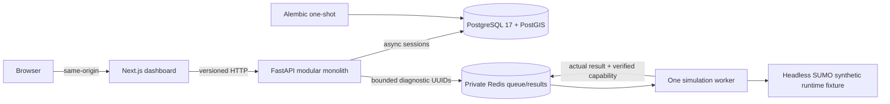

# EARTHMIND · 0.1.0


The geography recovery now opens a real **Downtown Dubai / Business Bay** OSM
network by default. The retained local snapshot contains 2,364 directed road
records and 1,560 intersection records. Cesium displays self-hosted OSM cartography
and 402 footprint models with explicit OSM height tags. These are partial-coverage
extrusions, not photorealistic ion tiles or field-verified building dimensions.
Synthetic fixtures require **Development datasets** mode.

```sh
make setup
make dev
# Explicit first download/import; retained checksummed snapshots are reused:
make import-dubai
uv run --locked python scripts/verify_real_geography.py
make smoke-real
```

The final command runs 3 synthetic vehicles on actual mapped imported roads and
retains recorded SUMO output. It does not connect live traffic or animate fake
vehicles. For browser acceptance, run `CITY_DIAGNOSTICS_ENABLED=true make dev`
then `npm run test:browser -- --workers=1`. Public provider credentials remain
optional; configure `CESIUM_ION_PUBLIC_TOKEN` and `CITY_IMAGERY_MODE=ion` for
licensed ion imagery/building tiles. No token was fabricated.

[Actual recovery results](docs/verification.md),
[source/import workflow](docs/osm-import.md),
[geographic architecture and limits](docs/recovery-geography.md).

**AI-Powered Urban Intelligence Platform** — a local-first foundation for a
Dubai urban digital twin research platform.

M03 adds an interactive Cesium 3D City Explorer to M02's PostGIS region/network
storage, provenance, bounded spatial APIs and Geospatial Data dashboard.
M02 supplies an illustrative Dubai study polygon and a clearly synthetic graph;
real Dubai road ingestion, traffic execution, operational telemetry and AI
forecasting remain later work. M01 health/capability contracts retain version 0.1.0 and their
original M01 identity for compatibility; Geospatial Data is M02 and City Explorer
is M03.

## Launch on Apple Silicon

Requirements: macOS ARM64, Git, Make, Node 22 LTS, npm 10+, uv 0.11.12, and
Docker Desktop running a native ARM64 Linux engine. Python 3.12 is selected by
uv; the machine's default Python is not used implicitly.

```sh
cd /Users/redmug/EARTHMIND
make setup
make dev
make status
make smoke
```

Open [EARTHMIND](http://localhost:3000) or [API docs](http://localhost:8000/docs).
PostgreSQL is bound to **127.0.0.1:5434**; Redis has no host port. New setup
creates an ignored `.env` with a generated local password and owner-only access.
Existing credentials are preserved; setup appends a generated development write
token only when its key is missing. Re-run `make dev` to rebuild source changes,
apply migrations, seed the idempotent synthetic fixture and run the API, spatial and Cesium asset smoke checks.
Select **Geospatial Data** in the dashboard to inspect the real persisted data.

## Implemented in M03

- A lazy browser-only CesiumJS 1.146.0 globe, selected-region overlays, batched
  road centerlines, stored intersection markers and deterministic feature picking.
- Dubai Overview, Downtown Dubai and Business Bay cameras; region/feature focus,
  top-down/perspective, zoom/reset, layer controls and an accurate metadata inspector.
- Bounded camera queries with cancellation, runtime schemas, paginated feature
  loading and inactive-viewport cache eviction. PostgreSQL remains authoritative.
- Locally hosted Workers/ThirdParty/Assets/Widgets, low-resolution Natural Earth
  imagery and ellipsoid terrain work without an account or external tile requests.
- Optional licensed Cesium ion imagery/terrain/OSM Buildings with public-token
  configuration, provider errors, attribution and explicit missing-access states.
- Responsive desktop/tablet/mobile inspection, keyboard feature controls,
  WebGL fallback and opt-in local rendering diagnostics.

Select **City Explorer** in the dashboard. Navigation and M02 overlays work
without a simulation. Optional ion building tiles require authorized provider access; no real
building coverage, traffic, signal observations or forecast is invented.

## Implemented in M02

- Thirteen UUID/UTC persistence tables sharing M01's ORM base, engine and Alembic
  environment; head `0004_run_state_integrity` preserves existing M01 data.
- EPSG:4326 geometries with database validity/vertex constraints, GiST indexes,
  geodesic area/length and bounded bbox, polygon and meter-distance queries.
- Explicit edge endpoints, same-network foreign keys, publication immutability,
  scenario/demand consistency and strict persisted run states.
- Fourteen typed spatial/provenance endpoints and a responsive Geospatial Data
  module with actual loading, empty, error/retry and structural validation states.
- Stable synthetic seed: `dubai-downtown-demo`, six intersections, eight edges,
  simulated signal metadata, recorded license/attribution and content checksum.
- Actual PostGIS, API, browser, migration and M01 worker/SUMO regression checks.

The users, demand, scenario, intervention, run, metric and artifact tables provide
persistence contracts. M02 does not execute scenarios, authenticate users, import
OSM, verify real signal locations, or convert the graph into a SUMO network.

## Preserved M01 foundation

- A responsive dark mission-control dashboard with nine navigation sections,
  real health/capability data, loading/offline/retry states and actual diagnostic
  actions. Future sections are clearly labeled as later milestones.
- Versioned FastAPI health, readiness, capability and diagnostic APIs; typed
  settings/responses, safe error handling and JSON application logging.
- PostgreSQL 17/PostGIS, Alembic, constrained UUID/UTC system metadata, and
  injected SQLAlchemy async sessions with commit/rollback lifecycle.
- A private Redis queue with atomic capacity checks, expiring job records, one
  separately executable worker, bounded retries and diagnostic execution.
- Pinned ARM64 headless SUMO/netconvert and matching Python clients. A tiny
  labeled synthetic fixture actually runs through TraCI and produces parsed XML.
- Locked npm/uv workspaces, strict checks, unit/integration/browser tests,
  pre-commit hooks and a native ARM64 GitHub Actions workflow.

## Architecture



The API never executes SUMO. It enqueues an allowlisted diagnostic and polls its
result. The worker runs native tools in a bounded child process. Capability
`simulation_runtime` is true only while a fresh verified worker record exists.
`dubai_network_import`, `traffic_simulation` and `ai_forecasting` remain false.

## Technology

| Area | Selected stack |
| --- | --- |
| Web | Next.js 16.4.3, React 19.3.1, strict TypeScript, Tailwind 4.3.3 |
| Web state/validation | TanStack Query 5.105.0, Zod 4.6.7, Lucide 1.61.0 |
| 3D visualization | CesiumJS 1.146.0, local runtime assets, optional scoped ion providers |
| API | Python 3.12, FastAPI, Pydantic v2, SQLAlchemy 2, psycopg 3, Alembic |
| Data | PostgreSQL 17, PostGIS 3.6.4, Redis 7.4 |
| Runtime | SUMO/netconvert 1.15.0; traci/sumolib 1.15.0 |
| Checks | pytest, Ruff, strict mypy, ESLint, tsc, Playwright 1.64.1 |

Exact application artifacts are in `uv.lock` and `package-lock.json`. Base
images are pinned by digest. The selected upstream PostGIS image lacks ARM64,
so a custom native image installs exact PostGIS packages. Top-level PostGIS and
SUMO packages are pinned; transitive system packages still use live repositories.
See the [architecture decisions](docs/decisions) for that reproducibility limit.
The read-only geospatial dashboard uses selectors and action buttons; region
creation is a development API operation rather than a browser form.

## Commands

| Command | Behavior |
| --- | --- |
| `make setup` | Validate tools/ARM64, preserve or create private config, install locks/hooks |
| `make dev` | Build/start services, migrate, seed, verify native architecture and all smokes |
| `make down` | Stop this project; preserve named volumes |
| `make test` | Backend/worker unit tests and frontend tests |
| `make lint` | Lock/schema consistency, Ruff, ESLint and type checks |
| `make typecheck` | Strict mypy and TypeScript |
| `make migrate` | Apply Alembic upgrades through the one-shot container |
| `make seed` | Idempotently persist the synthetic M02 study region and graph |
| `make smoke` | Real M01 queue/SUMO, M02 API/PostGIS/web and M03 Cesium asset checks |
| `make logs` | Show bounded service logs |
| `make status` | Show every service and migration status |
| `make clean` | Remove known disposable caches only |
| `make build` | Build the standalone production frontend |

Additional verification (enable local diagnostics for the native canvas-picking
browser checks; ordinary startup keeps them disabled):

```sh
CITY_DIAGNOSTICS_ENABLED=true make dev
uv run --locked python scripts/database_checks.py
uv run --locked python scripts/inspect_geospatial_database.py --output docs/evidence/m03/postgis-inspection.json
uv run --locked python scripts/verify_migrations.py
CITY_DIAGNOSTICS_ENABLED=true uv run --locked python scripts/failure_smoke.py
npx playwright install chromium
npm run test:browser
uv run --locked python infra/verification/check_build_context.py
uv run --locked pre-commit run --all-files
```

`verify_migrations.py` creates its own isolated empty database project and removes
only its own fixture volumes. `failure_smoke.py` briefly stops this project's
worker/Redis/database and restores them. Run these against local development.
Run browser checks after the database suite has finished; integration checks
mutate isolated test transactions and should not contend with deployed browser
readiness observations. Do not run outage checks alongside browser tests.
Normal tests intentionally deselect live integration tests; `database_checks.py`
sets the live database configuration and runs them explicitly.

## Repository

```text
apps/api/src/earthmind_api/    API, settings, logging, sessions, models and queue client
apps/api/migrations/          M01 extension/metadata and M02 spatial/integrity revisions
apps/web/                     App Router, components, API boundary and browser tests
packages/contracts/           Pydantic → JSON → generated TypeScript/Zod contracts
packages/simulation-worker/   Queue consumer, SUMO runtime and synthetic fixture
infra/                        Dockerfiles, image manifests and context regression
scripts/                      Bootstrap, environment, smoke and migration verification
docs/                         Setup, security, decisions and actual verification evidence
.github/workflows/ci.yml      Native ARM64 quality/integration workflow
```

The established installable Python `src` layout and root Next.js `app` layout
are maintained deliberately; see ADR 0001. No unnecessary microservices are added.

## Documentation and limitations

- [Setup](docs/setup.md), [operations](docs/operations.md), [troubleshooting](docs/troubleshooting.md)
- [Architecture](docs/architecture.md), [security](docs/security.md), [decisions](docs/decisions)
- [Cesium setup and token configuration](docs/cesium-integration.md), [3D scene](docs/3d-digital-twin.md)
- [Frontend architecture](docs/frontend-architecture.md), [performance observations](docs/performance.md)
- [Geospatial architecture](docs/geospatial-architecture.md), [schema/ER diagram](docs/database-schema.md)
- [Spatial API and examples](docs/api.md), [dataset provenance](docs/data-sources.md)
- [Actual M03 commands, results, failures and acceptance](docs/verification.md)
- [Preserved M02 verification](docs/verification-m02.md), [M01 verification](docs/verification-m01.md)

This is a local development stack using production builds. Shared deployment
requires role separation, authentication, TLS, managed secrets and tested
backups. The API/migration database role is privileged; diagnostic endpoints are
unauthenticated. Queue consumption is at-most-once for M01 diagnostics. Hosted
CI must be reported separately from local checks. The repository is proprietary;
see `LICENSE`.

`POST /api/v1/regions` requires `X-Earthmind-Dev-Token` matching the generated
`EARTHMIND_DEV_WRITE_TOKEN`. The token is not passed to the browser or worker;
blank configuration disables creation. Other spatial endpoints are read-only
or geometry calculations. This is a local development gate, not user identity.
Keep the loopback bindings; shared deployment requires the security work above.

The explicitly requested recovery adds real OSM import and a limited synthetic-demand SUMO smoke. No separate M04 work or operational traffic/AI feature is started.

For a scoped public Cesium ion token, use the documented `CESIUM_ION_PUBLIC_TOKEN`
runtime setting in ignored `.env`, recreate web and reload the viewer. No private
server token belongs in that setting. Missing access explicitly blocks optional
ion building tiles/terrain while the local globe and PostGIS overlays remain usable.

Rendering verification and optional local diagnostics:

```sh
CITY_DIAGNOSTICS_ENABLED=true make dev
npm run test:browser
uv run --locked python scripts/verify_city_performance.py
```

The performance command creates a clearly synthetic temporary 300-road dataset
in actual PostGIS, uses the real browser/APIs, and removes only its own records
in a finally block. It never resets normal volumes or converts the seed into a
traffic simulation. Generated Cesium assets are copied at build/dev startup and
stay outside Git. See the performance report for measured scope and limitations.

The current stable Cesium engine needs a documented three-statement lifecycle
patch. `npm ci` applies it using pinned patch-package; dev/build verify the exact
patched source hash. Do not skip install scripts. See [ADR0011](docs/decisions/0011-cesium-lifecycle-patch.md)
before upgrading Cesium or removing the patch.
