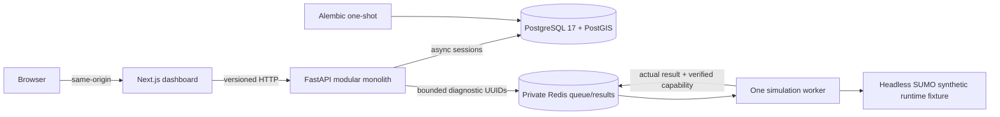

# EARTHMIND · 0.1.0

**AI-Powered Urban Intelligence Platform** — a local-first foundation for a
Dubai urban digital twin research platform.

M01 provides working application infrastructure, real service health, a bounded
diagnostic queue, and verified headless SUMO execution. Geographic ingestion,
Dubai traffic scenarios, digital twins, and AI forecasting remain later work.

## Launch on Apple Silicon

Requirements: macOS ARM64, Git, Make, Node 22 LTS, npm 10+, uv 0.11.12, and
Docker Desktop running a native ARM64 Linux engine. Python 3.12 is selected by
uv; the machine's default Python is not used implicitly.

```sh
cd /Users/redmug/EARTHMIND
make setup
make dev
make status
make smoke
```

Open [EARTHMIND](http://localhost:3000) or [API docs](http://localhost:8000/docs).
PostgreSQL is bound to **127.0.0.1:5434**; Redis has no host port. New setup
creates an ignored `.env` with a generated local password and owner-only access.
Existing configuration is preserved. Re-run `make dev` to rebuild source changes.

## Implemented in M01

- A responsive dark mission-control dashboard with nine navigation sections,
  real health/capability data, loading/offline/retry states and actual diagnostic
  actions. Future sections are clearly labeled as later milestones.
- Versioned FastAPI health, readiness, capability and diagnostic APIs; typed
  settings/responses, safe error handling and JSON application logging.
- PostgreSQL 17/PostGIS, Alembic, constrained UUID/UTC system metadata, and
  injected SQLAlchemy async sessions with commit/rollback lifecycle.
- A private Redis queue with atomic capacity checks, expiring job records, one
  separately executable worker, bounded retries and diagnostic execution.
- Pinned ARM64 headless SUMO/netconvert and matching Python clients. A tiny
  labeled synthetic fixture actually runs through TraCI and produces parsed XML.
- Locked npm/uv workspaces, strict checks, unit/integration/browser tests,
  pre-commit hooks and a native ARM64 GitHub Actions workflow.

## Architecture



The API never executes SUMO. It enqueues an allowlisted diagnostic and polls its
result. The worker runs native tools in a bounded child process. Capability
`simulation_runtime` is true only while a fresh verified worker record exists.
`dubai_network_import`, `traffic_simulation` and `ai_forecasting` remain false.

## Technology

| Area | Selected stack |
| --- | --- |
| Web | Next.js 16.4.3, React 19.3.1, strict TypeScript, Tailwind 4.3.3 |
| Web state/validation | TanStack Query 5.105.0, Zod 4.6.7, Lucide 1.61.0 |
| API | Python 3.12, FastAPI, Pydantic v2, SQLAlchemy 2, psycopg 3, Alembic |
| Data | PostgreSQL 17, PostGIS 3.6.4, Redis 7.4 |
| Runtime | SUMO/netconvert 1.15.0; traci/sumolib 1.15.0 |
| Checks | pytest, Ruff, strict mypy, ESLint, tsc, Playwright 1.64.1 |

Exact application artifacts are in `uv.lock` and `package-lock.json`. Base
images are pinned by digest. The selected upstream PostGIS image lacks ARM64,
so a custom native image installs exact PostGIS packages. Top-level PostGIS and
SUMO packages are pinned; transitive system packages still use live repositories.
See the [architecture decisions](docs/decisions) for that reproducibility limit.
React Hook Form is unnecessary in M01 because diagnostics use action buttons,
not a data-entry form.

## Commands

| Command | Behavior |
| --- | --- |
| `make setup` | Validate tools/ARM64, preserve or create private config, install locks/hooks |
| `make dev` | Build/start all services, migrate once, verify architecture and smoke |
| `make down` | Stop this project; preserve named volumes |
| `make test` | Backend/worker unit tests and frontend tests |
| `make lint` | Lock/schema consistency, Ruff, ESLint and type checks |
| `make typecheck` | Strict mypy and TypeScript |
| `make migrate` | Apply Alembic upgrades through the one-shot container |
| `make smoke` | Real HTTP → Redis → worker diagnostic and SUMO execution |
| `make logs` | Show bounded service logs |
| `make status` | Show every service and migration status |
| `make clean` | Remove known disposable caches only |
| `make build` | Build the standalone production frontend |

Additional verification:

```sh
uv run --locked python scripts/database_checks.py
uv run --locked python scripts/verify_migrations.py
uv run --locked python scripts/failure_smoke.py
npx playwright install chromium
npm run test:browser
uv run --locked python infra/verification/check_build_context.py
uv run --locked pre-commit run --all-files
```

`verify_migrations.py` creates its own isolated empty database project and removes
only its own fixture volumes. `failure_smoke.py` briefly stops this project's
worker/Redis/database and restores them. Run these against local development.
Normal tests intentionally deselect live integration tests; `database_checks.py`
sets the live database configuration and runs them explicitly.

## Repository

```text
apps/api/src/earthmind_api/    API, settings, logging, sessions, models and queue client
apps/api/migrations/          Extension and UUID/UTC metadata revisions
apps/web/                     App Router, components, API boundary and browser tests
packages/contracts/           Pydantic → JSON → generated TypeScript/Zod contracts
packages/simulation-worker/   Queue consumer, SUMO runtime and synthetic fixture
infra/                        Dockerfiles, image manifests and context regression
scripts/                      Bootstrap, environment, smoke and migration verification
docs/                         Setup, security, decisions and actual verification evidence
.github/workflows/ci.yml      Native ARM64 quality/integration workflow
```

The established installable Python `src` layout and root Next.js `app` layout
are maintained deliberately; see ADR 0001. No unnecessary microservices are added.

## Documentation and limitations

- [Setup](docs/setup.md), [operations](docs/operations.md), [troubleshooting](docs/troubleshooting.md)
- [Architecture](docs/architecture.md), [security](docs/security.md), [decisions](docs/decisions)
- [Actual commands, results, failures and acceptance](docs/verification.md)

This is a local development stack using production builds. Shared deployment
requires role separation, authentication, TLS, managed secrets and tested
backups. The API/migration database role is privileged; diagnostic endpoints are
unauthenticated. Queue consumption is at-most-once for M01 diagnostics. Hosted
CI must be reported separately from local checks. The repository is proprietary;
see `LICENSE`.

The roadmap proceeds from this verified foundation to geographic data and
research workflows in later milestones. M02 implementation is outside this work.
