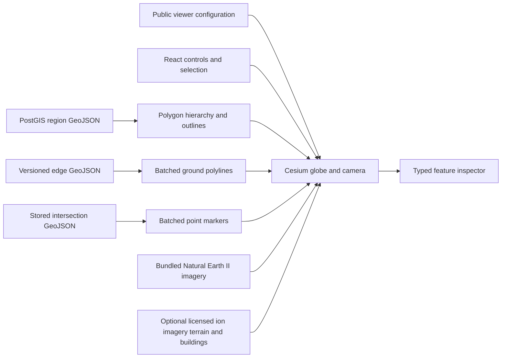

# M03 — Dubai 3D geographic workspace

This original M03 guide is historical. The subsequent [real geography recovery](recovery-geography.md) changes the default dataset to retained OSM/PostGIS roads. Current Engineering/Realistic City modes and authorized ion setup are in the [ion integration guide](cesium-ion-integration.md), with [actual verification](verification-cesium-ion.md).

City Explorer is a CesiumJS visualization of geographic context and stored study
data. It extends the existing EARTHMIND dashboard; Geospatial Data, system
health, diagnostics and the M01 worker remain separate working surfaces.
PostgreSQL/PostGIS is still the authority for study regions, network geometry,
feature attributes and dataset provenance.

M03 does not import a real Dubai road network, execute a scenario, animate
vehicles, infer traffic, or control infrastructure. A rendered road is a stored
feature, not evidence of surveyed or operational infrastructure.

## Open the workspace

Run the existing local setup and deployment commands, then choose **City
Explorer** from the dashboard navigation:

```sh
make setup
make dev
```

The default local web URL is `http://localhost:3000`; the FastAPI documentation
is at `http://localhost:8000/docs`. Database host port remains **5434** and all host
bindings remain on loopback. `make dev` retains existing named volumes, applies
migrations, seeds the idempotent M02 fixture and runs the established deployment
smokes. See [verification](verification.md) for actual executed browser/build and
smoke results; the instructions here are not execution evidence.

The interface selects the registered `dubai-downtown-demo` region when available,
then a published network when one exists. Other stored regions and versions can
be selected using the two dropdowns. If the catalogs are empty, the globe can
still provide geographic context; the interface does not fabricate a network.

## Scene composition



| Layer | Source and display | Control behavior |
| --- | --- | --- |
| Study region | Backend MultiPolygon, semi-transparent interior, separate ring outlines; polygon holes are retained | Shows/hides region fill and outlines |
| Road centerlines | Backend LineString features converted into batched `GroundPolylinePrimitive` instances | Shows/hides native road primitives; class styling remains tied to stored road category |
| Intersections | Backend Point features in a `PointPrimitiveCollection` | Shows/hides markers; distance-dependent rendering reduces distant clutter |
| 3D buildings | Optional Cesium OSM Buildings tileset | Loads/removes a native tileset when configured; missing access is explicitly blocked |
| Basemap imagery | Bundled Natural Earth II without a token, or configured Cesium ion imagery | Adds/removes the actual imagery layer |
| World terrain | Configured Cesium ion terrain; otherwise the WGS84 ellipsoid | Enables the terrain provider or restores the ellipsoid |
| Selection highlight | White road highlight or intersection outline | Controls highlighting independently of the selection's metadata |
| Region centroid | Backend-derived representative centroid | Shows/hides the centroid marker |

Road categories use restrained class colors: motorway/trunk, primary/secondary
and other classes have separate styling. The small synthetic fixture uses the
synthetic local category. One-way status is shown as stored metadata; these
centerlines do not implement a routing or turn-restriction engine.

Intersections with a stored `is_signalized=true` flag use the signal color.
Other markers use the neutral network color. Absence of that flag is not proof
of an unsignalized real-world intersection: the inspector shows **Not recorded**.
For synthetic records, the field is labeled **Simulated signalized flag**.
Markers have a small visualization height offset and do not represent surveyed
road or signal elevations. Marker visibility is also limited at distant camera
ranges; the overview is not an instruction to load every node in the city.

## Camera navigation

The initial reference camera is near longitude 55.2744, latitude 25.1972, with a
2,400-meter reference altitude. A selected region can subsequently fit the
camera to its recorded bounds. Camera reference coordinates are approximate
viewpoints, not official study boundaries.

| Command | Behavior |
| --- | --- |
| Dubai overview | Flies to the Dubai reference camera at 70,000 meters |
| Downtown Dubai | Flies near 55.2744, 25.1972 at 2,400 meters |
| Business Bay | Flies near 55.261, 25.182 at 3,500 meters |
| Zoom to study region | Fits backend region bounds with a perspective offset |
| Zoom to selected feature | Fits the selected road geometry or a small intersection view |
| Top-down view | Orbits the actual visible ground focus into a vertical viewing orientation |
| Perspective view | Orbits the same ground focus into an oblique viewing orientation |
| Zoom in/out | Applies a bounded camera movement relative to current altitude |
| Reset camera | Returns to the Downtown reference camera |

Transitions are animated by Cesium. Top-down/perspective changes use the
visible ground focus, with an ellipsoid/region-centroid fallback when needed,
instead of rotating at the displaced camera position and shifting away from
the study. A new camera command cancels an unfinished flight.

No simulation is required. The bottom bar reports actual camera longitude,
latitude and altitude from a settled pose, with an explicit pending state before
a snapshot exists. Camera pose is sampled at most once per 50 ms and must remain
stable for 350 ms within 0.05 m position/1e-7 direction or up-vector component
changes; viewport-size changes also reset settlement. Spatial requests then use
a separate 350 ms debounce. These are observation/query rules, not a measured
camera-to-data response-time promise. Building inspection does not invent
feature bounds: road/intersection zoom controls are unavailable for a
building-only selection.

## Feature selection and inspection

The scene performs a bounded native `drillPick`. Selection priority is:

1. Intersection.
2. Road.
3. Provider building.

Study-region fill and outlines do not replace a selectable road/node identity.
An empty pick deselects. The inspector's visible-feature list offers a keyboard
alternative to canvas picking; it lists up to 100 of the retained features, with
an explicit message when more remain. The layer must be enabled to select it
from that list. **Deselect** or Escape clears the geographic selection.

A road inspector displays its stored UUID, provisional/source identifiers,
name when available, category, lanes, speed in meters per second, geodesic
length in meters, one-way flag and explicit endpoint identifiers. It also shows
the selected network version, source record, dataset type and structural
validation state. Intersection inspection uses recorded node identifiers,
category, position and optional signal metadata instead of inventing road-only
attributes. Numeric formatting is presentation only; the stored values remain
owned by the backend. Missing values show **Not recorded**.

Building inspection includes only available bounded primitive provider
properties. Provider element-type/ID keys are kept distinct; a missing source
identifier uses an opaque viewer-local selection key instead of a fabricated
UUID. No building name or height is manufactured. A provider property
whose name denotes an estimated height remains an estimate; it must not be
relabeled as a surveyed height. Building metadata and coverage vary by feature
and location. See [Cesium's provider description](https://cesium.com/platform/cesium-ion/content/cesium-osm-buildings/).

All metadata is rendered as React text. Provider objects and raw HTML do not
enter the inspector. Credential-like property keys are filtered; limits on keys
and string lengths keep the inspected payload bounded.

## Study identity and provenance

The M02 fixture is **Downtown Dubai — Synthetic Study Region**, with six
invented intersections, eight synthetic links and stable provisional feature
identifiers. Its polygon is illustrative. A signalized fixture node is a
simulated metadata record, not a claimed real Dubai traffic signal.

The scene, inspector and summaries preserve the stored synthetic labels. A
false `is_synthetic` value means only that a record is not marked synthetic; it
is not a verification certificate or proof of a real import. The interface uses
**Stored source** language and displays the recorded source type, license,
version and attribution for review. No unrecorded observation date, traffic
metric or accuracy claim is inferred.

Region area and bounds come from FastAPI/PostGIS. The frontend never computes
square kilometers from longitude/latitude degree values. M02 structural network
validation remains structural: a VALID report does not establish real-world
road accuracy. See [data provenance](data-sources.md) and
[geospatial architecture](geospatial-architecture.md).

## Optional providers and attribution

Without an external token, the application uses Cesium's bundled Natural Earth
II reference imagery and an ellipsoid globe. These same-origin assets make the
base globe usable without paid imagery or a remote tile account. Natural Earth
is public-domain raster/vector data; EARTHMIND retains a visible credit anyway.
Its coarse basemap is not high-resolution Dubai imagery. See the
[official Natural Earth terms](https://www.naturalearthdata.com/about/terms-of-use/).

The buildings and terrain controls are disabled with an explicit blocked
message until a developer configures a scoped public visualization token.
The optional provider state is distinct from the application's health: absent
building access does not make stored regions or road overlays fail.

With configured access, Cesium's async factories create provider objects and
Cesium's credit display remains in place. Loading, authentication/asset-access
failure and later tile failures are visible states. EARTHMIND does not scrape or
bulk-download external tiles and does not promise uniform building coverage.
OSM-derived data has its own attribution/license obligations; public access to a
service does not erase them. Review the
[OpenStreetMap license](https://www.openstreetmap.org/copyright) and the
[Cesium OSM Buildings attribution requirements](https://cesium.com/platform/cesium-ion/content/cesium-osm-buildings/).

Token setup, static assets and lifecycle details are documented in
[Cesium integration](cesium-integration.md). Only the explicitly public viewer
token is eligible for browser configuration; private GIS credentials and the
M02 write token remain server-only.

## Display and verification limits

Roads and intersections are queried by bounded viewport, with at most 500
features and 25,000 retained coordinate positions per layer. Registry catalogs
are capped at 500 items. The UI reports truncation and asks the user to zoom
closer rather than silently presenting a complete Dubai-scale network. The
current fixture edges each have two coordinate positions; they require no
shape-distorting simplification. M03 preserves their coordinates during display.
A later dense import needs an explicitly tested display/LOD strategy instead
of discarding geometry without a documented accuracy policy.

The interface's enabled switches are requested state; native layer visibility
and readiness are observed separately. A road count is reported only when the
road primitive is enabled and ready. Intersection counts respect enabled state
and the distant-view rule. These are native scene-object readiness summaries,
not pixel-by-pixel visibility counts or proof every feature is on screen.

The optional local diagnostics panel reports actual rendered-frame/FPS samples
and browser JS heap when the browser exposes it. Request-render idle time is
not animation throughput and JS heap does not include GPU allocations. No
hardware FPS, GPU-memory, long-term memory-growth or production-load result is
implied here. Automated Chromium using SwiftShader is software-rendering
coverage and must not be described as an Apple Silicon hardware FPS benchmark.

Changing public provider configuration replaces provider resources without
rebuilding the whole globe. Region/network changes evict inactive spatial query
keys (`gcTime:0`) rather than retaining a succession of large viewport arrays.
On exit, the integration explicitly destroys its public native input handler,
then the Viewer, and requests release of the owned WebGL context when the
standard extension is available. Canvas removal alone does not demonstrate that
native DOM/listener resources were released; repeated-remount observations are
recorded separately. Test scopes, screenshots and measured observations belong
in [verification](verification.md) and [performance](performance.md).
