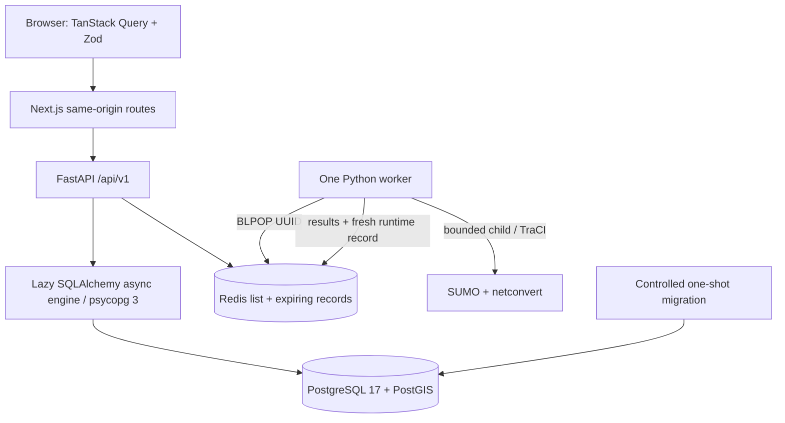
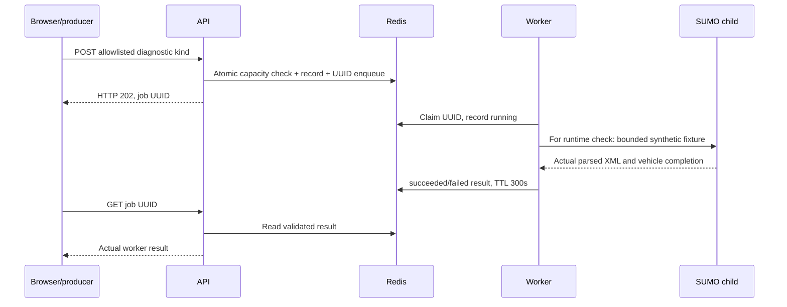

# M01 architecture

EARTHMIND is a local-first modular monolith with one separately executable
simulation worker. It is an engineering foundation for Dubai urban intelligence;
M01 does not ingest real geographic networks or claim predictive traffic results.

## Components and request flow

FastAPI owns health, capability reporting and diagnostic submission. Settings
and wire models are typed. Infrastructure is created in lifespan; the async
engine connects lazily and is reused. Injected sessions commit success and roll
back exceptions. Readiness runs real SQL/PostGIS, Redis PING and worker heartbeat
checks concurrently under deadlines. Liveness remains independent.

Routes: `GET /api/v1/health`, `GET /api/v1/ready`,
`GET /api/v1/system/capabilities`, `POST /api/v1/diagnostics`, and
`GET /api/v1/diagnostics/{uuid}`. Legacy `/health/live` and `/health/ready` aliases
remain for existing tooling. Next.js keeps Docker DNS and internal configuration
out of browser URLs. The diagnostic proxy requires JSON and validates the
browser-facing loopback origin rather than the standalone server's bind address.

## Database and startup

PostgreSQL publishes only 127.0.0.1:5434. Named volumes preserve data. The first
revision ensures PostGIS; `0002_system_metadata` creates constrained UUID metadata
with a unique application name, positive schema version, timezone-aware created
and updated timestamps, an index, and one EARTHMIND seed.

Database health requires ordinary SQL connectivity; migration installs PostGIS
before API readiness checks it. Compose starts data services, completes one
migration process, starts the worker, then API and web. Multiple API instances
never race to migrate.

## Queue and runtime boundary

Pending capacity is 20; one consumer executes a job at a time. Results expire
after 300 seconds. Worker heartbeat TTL is 30 seconds; verified SUMO capability
records expire after 60 seconds. Runtime probes and jobs are serialized, bounded
by wall time/step limits, and cancelled by killing their child process group.
Redis retries and container restart attempts are finite. A runtime failure
invalidates its capability record immediately. A crash after claiming a job can
leave a running record until expiry: at-most-once diagnostics are intentional.

SUMO and netconvert are pinned to the native Debian ARM64 engine 1.15.0, with
matching traci/sumolib. The synthetic fixture builds a two-edge network, steps
through TraCI, completes two vehicles, and parses tripinfo XML. This is runtime
verification, not a Dubai traffic scenario. FastAPI never executes native tools.

## Containers and resources

Every service uses `linux/arm64`; base image digests and registry manifests are
in `infra/verification`. The chosen upstream PostGIS image was confirmed
AMD64-only, so its replacement installs exact native packages on official
PostgreSQL 17 Bookworm. SUMO also uses an exact native package. Builds assert
TARGETARCH and dpkg architecture; `make dev` checks the engine and runtime images.

The Compose project network provides private service communication. Only web
3000, API 8000 and database 5434 are published, on loopback. Redis is unpublished.
Application containers run non-root with dropped capabilities, no-new-privileges,
CPU/memory/process limits and no Docker socket. One worker is configured. See
`compose.yaml` for exact limits and `security.md` for development-only risks.

## Locking and CI

npm and uv lock application dependencies. `uv_build==0.11.12` removes floating
isolated build-tool dependencies. Locked commands reject stale metadata.
Top-level PostGIS and SUMO apt versions are exact; transitive apt dependencies
remain live, so byte-identical system images are not claimed.

CI uses pinned official action commits and a native `ubuntu-24.04-arm` runner.
It repeats quality, production build, migrations, real queue/SUMO smoke, failure
recovery, browser and Docker context checks. Hosted execution is NOT RUN until
this repository is published and a workflow actually completes. Local results
are recorded separately in `verification.md`.

See the eight [architecture decision records](decisions) for component choices,
ARM64 evidence, queue delivery semantics and deployment boundaries.

M02 extends this preserved foundation with the shared PostGIS spatial schema,
provenance and bounded geospatial APIs. See [M02 architecture](geospatial-architecture.md)
and [ADR 0009](decisions/0009-geospatial-foundation.md) for the additive design.

M03 extends the same application with a lazy browser-only Cesium viewer. React
owns interface/query/typed-selection state; a mount-scoped controller owns the
SDK viewer, camera, native primitives and providers. The existing read-only
Next proxy and bounded M02 FastAPI endpoints query the same PostGIS store. No
new service, ORM, migration or geographic source of truth is introduced.

See [frontend architecture](frontend-architecture.md), [3D scene](3d-digital-twin.md),
[ADR 0010](decisions/0010-cesium-viewer.md) and
[ADR 0011](decisions/0011-cesium-lifecycle-patch.md). Provider access is optional;
the credential-free packaged Natural Earth/ellipsoid fallback remains usable.
The accepted SDK patch and explicit lifecycle cleanup have a version-locked
upgrade obligation and actual browser regression evidence.

The explicitly authorized Dubai recovery adds bounded OSM import and native SUMO
conversion in an offline CLI, while FastAPI remains read-only for map queries.
Source snapshots, checksums and many-to-many OSM/SUMO/DB mappings remain durable
ignored artifacts. PostGIS is the selected network source; source-derived OSM
cartographic context is a separate display provider, not another network store.
See [recovery architecture](recovery-geography.md) and
[ADR0012](decisions/0012-dubai-recovery.md). Synthetic demand is a bounded worker
smoke with recorded outputs; browser vehicle playback and live traffic are absent.
