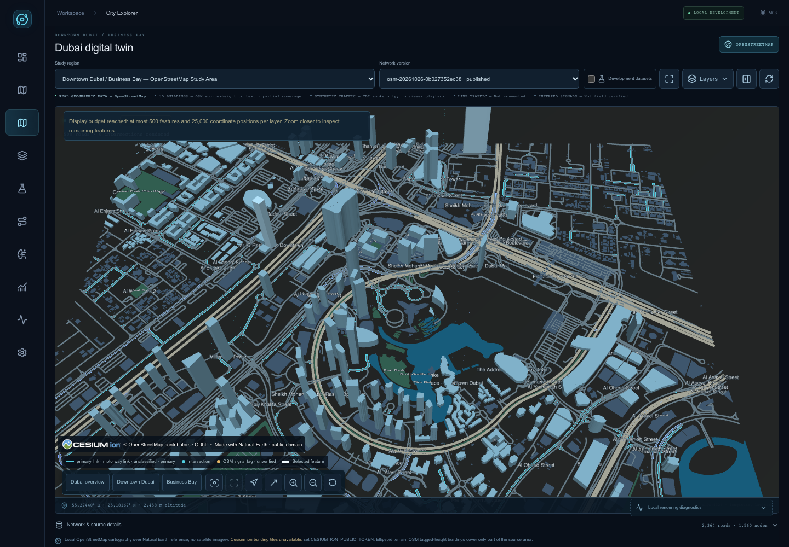

# City Explorer rendering diagnosis

Date: 2026-10-27. Initial inspected commit: `d9c529c7f14aebc85c90d56e7b92f612cc62dc1e`.
Scope: diagnose the running local viewer, then make minimal provider, camera-observability and overlay-visibility corrections. No redesign, OSM download/import, geographic edits or next milestone.

## Confirmed diagnosis before changes

The running checkout differs from the reported synthetic-only screenshot. The available evidence does not establish whether the reported screenshot came from an older deployment or an explicit development selection. An actual in-app browser inspection of `http://localhost:3000/` showed the real OSM region selected, development mode unchecked, visible source-height building extrusions and source cartography. Satellite imagery and Cesium ion building tiles are **not verified** and are unavailable with the current configuration.

| Observation | Confirmed cause / evidence |
| --- | --- |
| Flat or gray-green background at city scale | `CITY_IMAGERY_MODE=local-osm` uses packaged Natural Earth II underneath local OSM vectors, with brightness 0.22 and saturation 0.45. Natural Earth has only levels 0–2; its finest pixel spans 0.17578125 degrees (approximately 18 km east-west here). This cannot show Dubai satellite detail. |
| No ion imagery or buildings | Public token configured: **false**, checked in web container environment and the allowlisted runtime endpoint without printing the value. Default mode is local-osm; it does not request ion imagery. No provider access or coverage claim is possible. |
| Silent/misleading imagery fallback | Explicit `ion` mode with a missing token silently uses Natural Earth and reports ready. The footer can incorrectly call that local OSM cartography. Imagery errors can also be overwritten by ready after asynchronous context loading. |
| Camera/globe | Source initializes a visible WGS84 ellipsoid, centered on Downtown Dubai (55.2744 E, 25.1972 N), heading 0, target-ENU pitch offset -55 degrees, range 3,000 m. Browser position reads 55.27440 E, 25.18167 N, 2,458 m; this is the camera position south of its focus, not an incorrect target. Actual orientation/ground focus will be recorded through plain diagnostic snapshots in final browser evidence. Initial position/orientation are correct. Repeated checks later exposed a separate mesh-first ground-pick defect; the confirmed correction is recorded below. Target-local offsets and camera-local orientation also differ slightly on the curved globe. |
| Opaque region covering imagery | No such cover found: region fill is alpha 0.13, boundary is off by default. Canvas CSS has no opacity/filter. Local water/park/building polygons cover their actual footprints, not the whole viewport. |
| Synthetic-v1, 8 roads / 6 nodes | Explicit invented fixture in API `fixtures.py`, persisted by seed. Current catalog keeps it behind Development datasets. Existing real PostGIS version is already present and the current default. No import is needed to diagnose this checkout. |
| Missing Scenario Studio / Simulation Laboratory | Existing inactive workflow entries and explicit placeholder panels in `apps/web/components/dashboard.tsx`, not a Cesium failure. Completing those modules is outside this task. |

## Exact affected sources

- `apps/web/components/city/CesiumViewer.tsx`: browser-only lazy import, sets `/cesium/` base URL before loading SDK, DOM diagnostics and cleanup.
- `apps/web/components/city/runtime/scene-controller.ts`: Viewer options, baseLayer false followed by explicit provider creation, globe base color, camera focus, synthetic mode override, resource ownership.
- `apps/web/components/city/runtime/providers.ts`: imagery fallback/error/readiness, local context, optional ion buildings/terrain.
- `apps/web/components/city/runtime/camera.ts`, `apps/web/lib/geo/camera-presets.ts`: geographic camera commands and snapshots.
- `apps/web/components/city/runtime/layers.ts`: boundary alpha/visibility and bounded road/node layers.
- `apps/web/components/city/runtime/osm-context.ts`: source footprint/height loading and material visibility.
- `apps/web/components/city/CityExplorer.tsx`, `apps/web/components/city/LayerManager.tsx`: source labels, missing-token notice, provider-blocked control state.
- `apps/web/lib/city/config.ts`, `apps/web/app/api/city/config/route.ts`: allowlisted runtime public config; no bundled evaluation token is used.
- `apps/web/lib/city/catalog.ts`, `apps/web/hooks/use-city-data.ts`: real default and isolated development fixtures.
- `apps/api/src/earthmind_api/fixtures.py`, `apps/api/src/earthmind_api/seed.py`: synthetic source/persistence.
- `scripts/copy-cesium-assets.mjs`, `scripts/check_cesium_assets.py`: pinned static assets and HTTP checksum verification.

## Existing database and commands

Read-only inventory: PostgreSQL 17.11 aarch64, PostGIS 3.6, Alembic `0004_run_state_integrity`.

| Dataset | Region / network | Actual nodes / directed roads |
| --- | --- | --- |
| OpenStreetMap | `bc48f4d4-32de-543b-aafc-0b49369f8bc8` / `4aa62897-1a54-546c-a390-ddb156838f8e`, `osm-20261026-0b027352ec38` | 1,560 / 2,364, VALID_WITH_WARNINGS |
| Synthetic fixture | `8d31afa3-5d52-59b5-a8bc-691b5867dfcb` / `22f68ce8-9247-5425-8342-827d86517ead`, `synthetic-v1` | 6 / 8, VALID |

Retained context has 4,676 cartographic features, 402 explicit-height buildings, 120 labels. It is vector cartography, not satellite photography or a complete 3D city. Untagged heights remain flat.

Available import entry points were inspected only: `make import-dubai` and `uv run --locked python scripts/import_dubai_osm.py {download,convert,import}`. They are **not executed in this diagnosis**.

## Baseline checks actually executed

- `make lint typecheck test build smoke`: exit **0**, 10.722 seconds. Ruff/ESLint/mypy/TypeScript and optimized Next build succeeded. Python **116 passed, 38 deselected**; TypeScript **88 passed**. Live M01 queue/SUMO fixture and M02 geospatial smoke succeeded. Five Cesium static asset HTTP hashes matched the pinned package. Browser worker/texture loading is being checked separately; HTTP metadata alone does not prove rendered textures.
- `uv run --locked python scripts/verify_real_geography.py`: exit **0**. Actual DB/API counts/provenance and deployed context hashes matched; synthetic fixture preserved. This is not browser imagery/ion coverage evidence.
- `docker compose ps --all --format json`: exit **0**, five long-running services healthy; migration container exited 0.
- `docker compose exec -T web node -e 'console.log(JSON.stringify({publicIonTokenConfigured:Boolean(process.env.CESIUM_ION_PUBLIC_TOKEN?.trim()),imageryMode:process.env.CITY_IMAGERY_MODE,imageryAssetId:process.env.CESIUM_ION_IMAGERY_ASSET_ID,terrainAssetId:process.env.CESIUM_ION_TERRAIN_ASSET_ID}))'`: exit **0**; local-osm, token presence false, asset IDs 3812/1.
- `uv run --locked python /private/tmp/earthmind-diagnosis-results/database_inventory.py`: exit **0**, transaction read-only; sanitized output retained for final evidence.

## Smallest fixes and prioritized recovery plan

1. Make explicit ion-without-token state blocked and label the actual fallback. Preserve provider failures until retry/toggle; do not replace them with a later success. Report tile/render readiness honestly.
2. Respect provider blocked states in layer controls. Label synthetic selections and unavailable providers consistently; preserve existing cartography and geographic records.
3. Record actual camera orientation, ground focus, globe/base-layer state and boundary alpha as plain values; verify presets and translucent overlay in a real browser. Change camera behavior only if evidence establishes a defect.
4. Verify actual worker and Natural Earth texture requests, not just asset metadata. Run existing browser/regression tests to a new evidence directory; retain historical reports.
5. Satellite recovery remains blocked on an owner-supplied scoped public ion token with imagery entitlement (or another explicitly authorized licensed provider). Then verify actual requests, loaded visible tiles, Dubai coverage and attribution in a browser. Do not substitute invented imagery or imply partial OSM extrusions are ion tiles.
6. Scenario UI, simulation playback and further geographic importing remain outside this diagnosis.

Final status: the independently executable local checks completed successfully. Licensed satellite imagery, ion building tiles and provider terrain remain BLOCKED / unverified; the exact accepted checks and failed attempts are recorded below.

## Findings from actual browser execution

Before changes, Playwright Chromium loaded the actual default real network, 500
bounded viewport road records, 402 local building entities and visible source
cartography/extrusions. Development mode reproduced synthetic-v1 with 8 roads,
6 nodes and zero local building entities. There were **0 console errors, 0 page
errors, 0 HTTP failures, 13 worker instances and 8 successful Natural Earth JPG
requests** across these two scenes. Three transport failures were exact
`net::ERR_ABORTED` on superseded spatial reads; they are retained in the evidence.
Four GPU ReadPixels stall warnings were also retained. These observations are
not a physical GPU performance certification. See
[before observations](evidence/city-diagnosis/browser-before/observations.json)
and [before real screenshot](evidence/city-diagnosis/browser-before/real-default.png).

Worker URLs included `createGeometry.js`, `combineGeometry.js`,
`createVerticesFromHeightmap.js` and `incrementallyBuildTerrainPicker.js` under
same-origin `/cesium/Workers/`. Dubai reference texture
`/cesium/Assets/Textures/NaturalEarthII/2/5/2.jpg` returned HTTP 200; the updated
HTTP verifier also confirmed its 16,112 bytes match the locked package SHA256.
No external provider request occurred in these local-mode checks. This rules
out a currently blocked worker/JPG request as the cause of the coarse background.

The in-app browser was also reloaded against the changed production service:
it first showed labels while geometry prepared, then visible road context and
height-tagged extrusions. That exposed an additional SDK-specific readiness
problem: installed `@cesium/engine/Source/DataSources/DataSourceDisplay.js:328`
keeps `ready` true once reached, including while newly added sources prepare.
That flag alone cannot establish current geometry readiness. The final fix uses
public scene primitive readiness checks after source adoption, without adding a
private SDK accessor. Final results below must establish the actual implementation.

### Failed attempts retained

1. First browser invocation exited **130** after interruption: **2 failed,
   1 interrupted, 36 not run**. Web recreation used the ignored `.env` default
   diagnostics=false instead of the existing runtime-only true override. In the
   same interval DB/Redis/worker were found Exited(0), API unhealthy. PostgreSQL
   logged a fast shutdown and Redis SIGTERM at 13:54:49 UTC. The initiator of that
   shutdown is **not established**. `CITY_DIAGNOSTICS_ENABLED=true docker compose
   --env-file .env up --detach --wait --wait-timeout 180` restored all services,
   without seeding/importing/resetting volumes. Diagnostics remain a runtime-only
   override; `.env` is preserved.
2. Second full browser invocation exited **1**: **36 passed, 3 failed** (376.566s).
   All three new actual-camera tests used a mistaken 0.01-degree pitch tolerance;
   the measured perspective difference was 0.01237717336979216 degrees. Cesium
   computes `flyToBoundingSphere` offsets in the target's ENU frame, but reports
   `Camera.pitch` in the camera's ENU frame. The corrected assertion uses the
   measured angle between those WGS84 up normals plus 0.001 degrees, retaining
   strict target-focus assertions. It does not move the camera or arbitrarily
   relabel the failed run. All 30 pre-existing browser regressions and 6 controlled
   diagnosis cases passed in that run.

[First log](evidence/city-diagnosis/browser-first.log),
[first report](evidence/city-diagnosis/browser-first/playwright-results.json),
[second log](evidence/city-diagnosis/browser-second.log),
[second report](evidence/city-diagnosis/browser-second/playwright-results.json).
Trace bundles remain temporary under `/private/tmp/earthmind-diagnosis-results`;
small failure screenshots/context and raw reports are retained in repository
evidence. No failed invocation is reported as PASS.

3. The expanded browser diagnostic initially failed strict TypeScript index checks
   (`quality-geometry`, exit **2**) and its concurrent Docker build failed
   (`deploy-geometry`, exit **1**). Tuple narrowing corrected those test-only
   errors. The production service retained the previous successful image until
   the corrected build completed. These failures remain in the command ledger.

## Implemented minimal corrections

- Explicit ion-without-token mode retains a usable Natural Earth reference but
  reports **blocked** with the real cause and source. It never silently claims
  satellite imagery. Real/synthetic renderer selection and labels share one policy.
- Provider failures stay latched through asynchronous completion until retry/toggle.
  Errors remain visible in the persistent footer even with Layers closed. Provider
  blocked reasons are displayed, while selected blocked layers can be switched off.
- Local source adoption waits for mount-owned native geometry batches to prepare
  and reach a further frame. The code reads public PrimitiveCollection length/get
  and Primitive/GroundPrimitive/GroundPolylinePrimitive.ready, not SDK private
  datasource/visualizer fields. A controlled real-worker hold/release checks the
  actual race: data can be loaded while geometry must remain loading.
- Optional ion buildings require visible nonempty tile content followed by a frame.
  This path remains **unverified with live ion**; unit/state guards are not a
  substitute for entitlement, Dubai coverage or pixel verification.
- Optional plain camera/scene diagnostics expose ground focus, heading/pitch,
  globe/tile state, imagery count and actual boundary alpha. No native viewer or
  credential escapes into globals or React state. Destination presets, default pose, globe visibility, source geometry, boundary
  styling and display budgets are preserved; flat-terrain orbit focus now uses
  the exact ellipsoid intersection described below.
- Asset smoke now hashes an actual Natural Earth JPG. Browser evidence records
  HTTP, worker, texture and transport failures, with bounded same-origin cancelled
  catalog/spatial reads explicitly classified and retained. Evidence destinations
  are isolated with EARTHMIND_EVIDENCE_DIR.

No schema, API ownership, dependency lock, geographic dataset or application layout
changes. No OSM download/import/context rebuild or next milestone was executed.
Production builds copy only existing validated context assets.

### Confirmed selection/cancellation rendering defect

A later full run (`browser-final`) exited **1** with **29 passed, 1 failed,
12 not run** (307.529s); the extra runner-level message was the configured
max-failures stop. Mobile repeated navigation left the existing synthetic fixture
at zero roads. Its trace showed the boundary/validation succeed, both spatial
requests cancelled, and no replacement query. This is a separate rendering/data
race, not an imagery entitlement failure.

`apps/web/hooks/use-city-data.ts` cancelled spatial queries unconditionally when
selecting even the already-active region/network. With the query key unchanged,
TanStack could restore the cancelled idle state without starting another fetch.
The City Explorer handlers also reset camera/selection on that redundant change.
Both entry points now ignore unchanged identifiers; actual scope changes still
cancel stale work.

The original uncontrolled trace is the primary proof: the road request began at
276751.890 ms, unchanged selection at 276753.846 ms, and both spatial reads
cancelled after about 10.5 ms, with no replacement. This is far below the 8s
request deadline. A held-response regression also failed before and passed after
the guard, but later runs exposed a deadline confounder in that first test design.
The corrected regression re-emits selections immediately and enforces acting
within half the existing request deadline, rather than waiting for imagery.
No geographic response is substituted and no new fixture/import is created.
See [before failure](evidence/city-diagnosis/reselect-regression-before.log) and
[after result](evidence/city-diagnosis/reselect-regression-after.log).

An earlier exploratory real-mode probe timed out at 12s but had 500 roads by its
final snapshot; that probe was inconclusive about a persistent blank scene and
is not used as the proof of this defect. Its actual output is retained as
[reselect-before.json](evidence/city-diagnosis/reselect-before.json).

### Additional repeated-run findings and corrections

`browser-delivery` completed with exit **1**, **40 passed / 5 failed** (431.328s).
Three selection-test failures included an overlong injected hold (two 8s request
deadlines in the desktop trace) and ordinary source/validation aborts during a
real/development scope switch. The harness now acts within 4s of the first held
request and explicitly retains/classifies the known same-origin UUID source,
boundary and validation GET aborts as well as catalog/spatial aborts. Production
timeouts were not relaxed. One desktop actual-scene test failed only that overly
narrow abort classification.

The remaining mobile actual-scene failure revealed a camera defect. With the
unchanged camera at 55.2744 E, 25.18167256 N, 2457.689 m, heading approximately
0/360 degrees and pitch -55.01547 degrees, the old mesh-first path first reported
focus [55.2744,25.1972], then [55.2744,25.57955165], about 42 km away.
[Extracted actual values](evidence/city-diagnosis/camera-pick-failure.json) preserve
this evidence. The precise internal SDK trigger is not established. The flat
ellipsoid surface has an exact analytic intersection, so
`apps/web/components/city/runtime/camera.ts` now uses Camera.pickEllipsoid for
EllipsoidTerrainProvider in snapshots and top-down/perspective commands. Provider
terrain keeps its terrain-aware path. The destination presets/default pose are
unchanged. This is a confirmed corrective camera change, beyond the initially
correct pose/orientation findings.

An optional attempt to run the saved pre-selection image for another before/after
comparison exited **125** because that image ID was no longer present locally; no
container started and no service/data changed. This is not reported as a browser
result. Original failed traces/source and the corrected final tests are the evidence.

## Final accepted results

- `make lint typecheck test build` (`quality-camera`): exit **0**. Ruff/ESLint,
  contract generation/lock check, mypy (48 source files), strict TypeScript and
  optimized Next production build pass. Python **116 passed / 38 deselected**;
  TypeScript **96 passed / 0 failed**.
- `uv run --locked python scripts/database_checks.py`: exit **0**, live PostGIS
  integration **38 passed / 85 deselected**. `make migrate`: exit **0**, existing
  head `0004_run_state_integrity`. No migration/schema change was introduced.
- Final actual Chromium run: **45 passed, 0 skipped, 0 unexpected, 0 flaky**,
  reporter duration **368.187s**, command-wrapper duration **368.755s**, exit **0**.
  It includes 30 preserved M01–M03 regressions plus 15 diagnosis cases across
  desktop/tablet/mobile. Tests use actual local services/source geometry; only
  explicitly labeled configuration/failure/transport controls are substituted.
- `make smoke`: final exit **0**, live frontend → API → PostGIS/Redis/worker
  and actual synthetic SUMO runtime fixture; original geospatial/write-gate smoke
  and six exact Cesium asset HTTP/hash checks, including the Dubai reference JPG.
- Final architecture script: exit **0**, engine aarch64 and every runtime image
  linux/arm64. No AMD64 emulation. Final five services are healthy; migrate exited 0.
- Final real-geography verifier/inventory: exits **0**. Existing region/network IDs,
  counts, source hashes, published status, catalog order and context manifest match
  the initial checked snapshot. Real 2364/1560 and synthetic 8/6 remain distinct.
- Six repository hooks pass. Staged credential/whitespace verification and final
  Git delivery are recorded with the local commit results; no push is performed.

[Accepted browser report](evidence/city-diagnosis/browser-acceptance/playwright-results.json),
[accepted browser log](evidence/city-diagnosis/browser-acceptance.log),
[summary](evidence/city-diagnosis/acceptance-summary.json),
[unchanged geography](evidence/city-diagnosis/database-inventory-comparison.json),
[final services](evidence/city-diagnosis/final-services.txt).

The actual local-scene checks in each viewport recorded **0 console errors,
0 HTTP failures, 13 worker instances and 4 successful Natural Earth JPGs**,
with **0 unexpected transport failures and 0 external provider requests**.
Retained abort counts were desktop 7, tablet 10, mobile 8; they are classified
known same-origin reads, not discarded. Controlled context failure separately
retains its intentional network error and verifies the visible persistent error.
The controlled worker hold verifies loaded source data stays loading until its
actual geometry prepares. The corrected same-selection case completes in
3.9s desktop / 2.8s tablet / 2.4s mobile, inside the unchanged request deadline.

The real browser verifies a visible globe, one imagery layer, completed local
geometry preparation, 402 loaded source-height models with visible extrusions,
actual native road picks, boundary alpha **0.13**, and geographic preset focus.
It does not assert all 402 models occupy visible pixels at once. The default
camera remains **55.2744 E, 25.18167256 N, 2457.689m**, heading approximately
0/360 degrees and camera-local pitch **-55.01547 degrees**, focused on
**[55.2744,25.1972]**. Business Bay, Downtown, top-down and perspective preserve
their requested ground focus with the corrected analytic flat-terrain path.

## Exact command ledger

All rows below were actually executed. Nonzero exits remain nonzero. Commands
were wrapped by `/private/tmp/earthmind-diagnosis-results/run_check.py` solely to
record stdout/stderr, elapsed time and exit status; the table shows their exact
child argv and runtime diagnostics override. Temporary evidence paths identify
the original runs; copies are retained under docs/evidence/city-diagnosis.

| Run / evidence | Exact executed command (repository cwd) | Exit | Seconds |
| --- | --- | ---: | ---: |
| [baseline](evidence/city-diagnosis/baseline.log) | `make lint typecheck test build smoke` | 0 | 10.722 |
| [database](evidence/city-diagnosis/database.log) | `uv run --locked python scripts/database_checks.py` | 0 | 2.132 |
| [migrations](evidence/city-diagnosis/migrations.log) | `make migrate` | 0 | 2.284 |
| [architecture](evidence/city-diagnosis/architecture.log) | `uv run --locked python scripts/check_architecture.py` | 0 | 0.669 |
| [quality](evidence/city-diagnosis/quality.log) | `make lint typecheck test build` | 0 | 12.64 |
| [deploy](evidence/city-diagnosis/deploy.log) | `docker compose --env-file .env up --build --detach --no-deps --wait --wait-timeout 180 web` | 0 | 15.148 |
| [browser-first](evidence/city-diagnosis/browser-first.log) | `env EARTHMIND_EVIDENCE_DIR=/private/tmp/earthmind-diagnosis-results/browser-first npm run test:browser -- --workers=1` | 130 | 68.807 |
| [restore](evidence/city-diagnosis/restore.log) | `CITY_DIAGNOSTICS_ENABLED=true docker compose --env-file .env up --detach --wait --wait-timeout 180` | 0 | 19.088 |
| [quality-final](evidence/city-diagnosis/quality-final.log) | `make lint typecheck test build` | 0 | 14.294 |
| [deploy-final](evidence/city-diagnosis/deploy-final.log) | `CITY_DIAGNOSTICS_ENABLED=true docker compose --env-file .env up --build --detach --no-deps --wait --wait-timeout 180 web` | 0 | 22.368 |
| [smoke-final](evidence/city-diagnosis/smoke-final.log) | `make smoke` | 0 | 1.091 |
| [browser-second](evidence/city-diagnosis/browser-second.log) | `env EARTHMIND_EVIDENCE_DIR=/private/tmp/earthmind-diagnosis-results/browser-second npm run test:browser -- --workers=1` | 1 | 376.566 |
| [quality-geometry](evidence/city-diagnosis/quality-geometry.log) | `make lint typecheck test build` | 2 | 3.951 |
| [deploy-geometry](evidence/city-diagnosis/deploy-geometry.log) | `CITY_DIAGNOSTICS_ENABLED=true docker compose --env-file .env up --build --detach --no-deps --wait --wait-timeout 180 web` | 1 | 7.417 |
| [quality-final2](evidence/city-diagnosis/quality-final2.log) | `make lint typecheck test build` | 0 | 11.819 |
| [deploy-final2](evidence/city-diagnosis/deploy-final2.log) | `CITY_DIAGNOSTICS_ENABLED=true docker compose --env-file .env up --build --detach --no-deps --wait --wait-timeout 180 web` | 0 | 13.481 |
| [frontend-final](evidence/city-diagnosis/frontend-final.log) | `npm run typecheck` | 0 | 1.201 |
| [worker-delay](evidence/city-diagnosis/worker-delay.log) | `env EARTHMIND_EVIDENCE_DIR=/private/tmp/earthmind-diagnosis-results/worker-delay npm run test:browser -- diagnosis.spec.ts --project=desktop --grep 'controlled worker delay' --workers=1` | 0 | 13.506 |
| [smoke-verified](evidence/city-diagnosis/smoke-verified.log) | `make smoke` | 0 | 1.09 |
| [architecture-final](evidence/city-diagnosis/architecture-final.log) | `uv run --locked python scripts/check_architecture.py` | 0 | 0.697 |
| [hooks](evidence/city-diagnosis/hooks.log) | `uv run --locked pre-commit run --all-files` | 0 | 4.423 |
| [staged-secret-check](evidence/city-diagnosis/staged-secret-check.log) | `uv run --locked python /private/tmp/earthmind-diagnosis-results/scan_changes.py` | 0 | 0.569 |
| [browser-final](evidence/city-diagnosis/browser-final.log) | `env EARTHMIND_EVIDENCE_DIR=/private/tmp/earthmind-diagnosis-results/browser-final npm run test:browser -- --workers=1 --max-failures=1` | 1 | 307.529 |
| [quality-selection](evidence/city-diagnosis/quality-selection.log) | `make lint typecheck test build` | 0 | 10.55 |
| [reselect-regression-before](evidence/city-diagnosis/reselect-regression-before.log) | `env EARTHMIND_EVIDENCE_DIR=/private/tmp/earthmind-diagnosis-results/reselect-regression-before npm run test:browser -- diagnosis.spec.ts --project=mobile --grep 'reselecting the active fixture' --workers=1` | 1 | 33.809 |
| [deploy-selection](evidence/city-diagnosis/deploy-selection.log) | `CITY_DIAGNOSTICS_ENABLED=true docker compose --env-file .env up --build --detach --no-deps --wait --wait-timeout 180 web` | 0 | 15.233 |
| [reselect-regression-after](evidence/city-diagnosis/reselect-regression-after.log) | `env EARTHMIND_EVIDENCE_DIR=/private/tmp/earthmind-diagnosis-results/reselect-regression-after npm run test:browser -- diagnosis.spec.ts --project=mobile --grep 'reselecting the active fixture' --workers=1` | 0 | 4.723 |
| [smoke-delivery](evidence/city-diagnosis/smoke-delivery.log) | `make smoke` | 0 | 1.021 |
| [hooks-delivery](evidence/city-diagnosis/hooks-delivery.log) | `uv run --locked pre-commit run --all-files` | 0 | 4.478 |
| [browser-delivery](evidence/city-diagnosis/browser-delivery.log) | `env EARTHMIND_EVIDENCE_DIR=/private/tmp/earthmind-diagnosis-results/browser-delivery npm run test:browser -- --workers=1` | 1 | 431.328 |
| [quality-camera](evidence/city-diagnosis/quality-camera.log) | `make lint typecheck test build` | 0 | 10.261 |
| [deploy-camera](evidence/city-diagnosis/deploy-camera.log) | `CITY_DIAGNOSTICS_ENABLED=true docker compose --env-file .env up --build --detach --no-deps --wait --wait-timeout 180 web` | 0 | 13.63 |
| [hooks-acceptance](evidence/city-diagnosis/hooks-acceptance.log) | `uv run --locked pre-commit run --all-files` | 0 | 4.302 |
| [smoke-acceptance](evidence/city-diagnosis/smoke-acceptance.log) | `make smoke` | 0 | 1.051 |
| [inventory-acceptance](evidence/city-diagnosis/inventory-acceptance.log) | `uv run --locked python /private/tmp/earthmind-diagnosis-results/database_inventory_after.py` | 0 | 0.2 |
| [architecture-acceptance](evidence/city-diagnosis/architecture-acceptance.log) | `uv run --locked python scripts/check_architecture.py` | 0 | 0.669 |
| [geography-acceptance](evidence/city-diagnosis/geography-acceptance.log) | `uv run --locked python scripts/verify_real_geography.py` | 0 | 0.182 |
| [browser-acceptance](evidence/city-diagnosis/browser-acceptance.log) | `env EARTHMIND_EVIDENCE_DIR=/private/tmp/earthmind-diagnosis-results/browser-acceptance npm run test:browser -- --workers=1` | 0 | 368.755 |
| [final-staged-secret-check](evidence/city-diagnosis/final-staged-secret-check.log) | `uv run --locked python /private/tmp/earthmind-diagnosis-results/scan_changes.py` | 0 | 1.098 |
| [capture-current](evidence/city-diagnosis/capture-current.log) | `node /private/tmp/earthmind-diagnosis-results/capture-current.mjs` | 0 | 13.076 |

The initial before capture was `node /private/tmp/earthmind-diagnosis-results/browser-before.mjs`
(exit 0). Its script and read-only SQL inventory source are retained as text
evidence for reproducibility. The exploratory `reselect-before.mjs` exited 1 and
is explicitly inconclusive as described above. The optional unavailable-image
command exited 125; it did not start a comparison service. No unavailable-image
or exploratory timeout is counted as an accepted browser test.

## Prioritized remaining recovery work and blockers

1. **BLOCKED — satellite imagery / ion buildings / provider terrain.** Public ion
   token configured is false. Explicit local-osm mode never requests satellite
   imagery; setting only a token without selecting the appropriate mode is not
   proof of access. An owner-supplied public, scoped visualization token with the
   required asset/origin entitlements and an authorized imagery asset is needed.
   Asset IDs 3812 (imagery), 1 (terrain), and SDK OSM buildings 96188 are configured
   or selected by the installed SDK; live access, content type and Dubai coverage
   are unverified. After configuration, verify actual requests/tiles/visible Dubai
   content and attribution in a browser. Do not borrow an evaluation token.
2. **Partial geographic coverage remains.** Local context is source-backed OSM
   cartography and simple explicit-height extrusions, not photography, a complete
   Dubai model or survey-verified metadata. Missing heights remain flat; no height
   guesses, geographic imports or source refreshes were performed. The real
   network retains VALID_WITH_WARNINGS and eight connected components.
3. **Operational finding unresolved.** Clean SIGTERM/fast shutdown of DB/Redis/worker
   occurred during verification. Services were restored and final health/smoke
   checks pass; the initiator remains unknown. This report does not attribute that
   host/service stop to Cesium or claim the cause was fixed.
4. **Intentionally absent workflows.** Scenario Studio and Simulation Laboratory
   remain explicit placeholders. Browser vehicle playback, operational traffic
   and scenario execution UI were not added. Those are not imagery fixes.

No redesign or next milestone was started. Stop before any further OSM download,
import or context rebuild. Historical M01–M03/recovery evidence is preserved.

Final still capture: `node /private/tmp/earthmind-diagnosis-results/capture-current.mjs`
exited **0** after waiting for a coherent native-ready, settled default view and
no loading message. It recorded **500 bounded roads, 402 loaded local models,
0 console errors and 0 HTTP failures**. The final screenshot above is from that
actual session; [capture observations](evidence/city-diagnosis/current-browser/observations.json).

## Git delivery

The source/test/architecture changes and isolated verification evidence form one
focused local commit. Six all-files hooks passed; configured credential/private-key/
artifact scans and whitespace checks passed. Exact staged inventory/diff and commit
output are retained under evidence/city-diagnosis. Historical evidence, dependency
locks, migrations, `.env` and ignored geographic source files remain preserved.
No push is performed.

The requested local commit actually exited **0**; all applicable commit hooks
passed and `git status --short` returned empty immediately afterward.
[Commit execution log](evidence/city-diagnosis/git-commit.log). A documentation-only
amendment of that same focused commit records this result and its output; the
final amended hash is reported from Git after completion. No push occurred.
