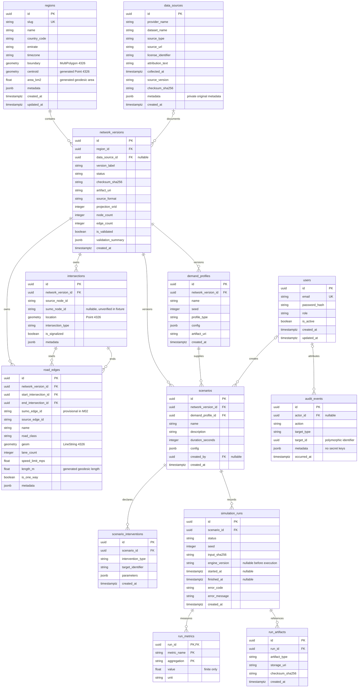
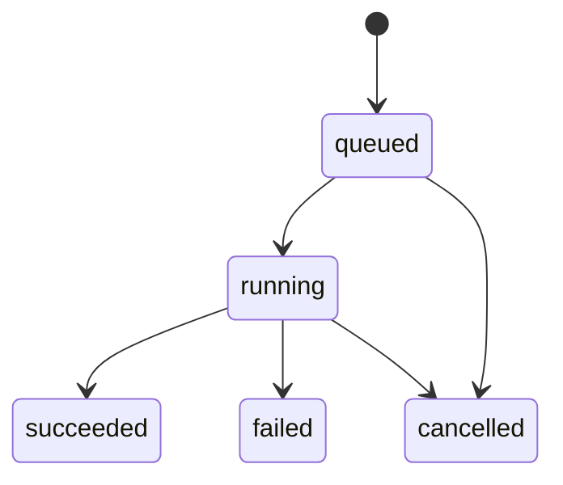

# M02 database schema

M02 extends the existing PostgreSQL 17/PostGIS database. It retains M01's
`system_metadata` table, ORM `Base`, settings, SQLAlchemy async engine, session
provider, and migration environment. There is no second database stack.

Migration chain:

```text
0001_postgis → 0002_system_metadata → 0003_geospatial_foundation
                                      → 0004_run_state_integrity
```

Revision 0003 contains frozen SQL snapshots for the 13 new tables, indexes and
integrity triggers. Revision 0004 adds run-state timestamp invariants and aligns
stored geometry with the public 5,000-coordinate limit. Applied revisions are
not rewritten to hide defects. Actual migration and regression results are in
[verification.md](verification.md).

## Entity relationships



`audit_events.target_id` is a UUID paired with `target_type`; it deliberately is
not a foreign key to one particular target table. Actor references are ordinary
nullable user foreign keys. The diagram's start/end relationships are separate
explicit topology references, not adjacency inferred from crossing lines.

## Spatial storage and indexes

Canonical geometries are nonempty, valid, two-dimensional EPSG:4326 values with
WGS84 ranges. Regions store MultiPolygon, edges LineString and intersections
Point. Typmods and named checks enforce these rules even for direct SQL writes.
Revision 0004 separately restricts region boundaries and edges to at most 5,000
coordinate positions, including polygon ring closures, matching public GeoJSON
serialization. The broader original 0003 validity check is retained unchanged.

| Index | Purpose |
| --- | --- |
| `ix_regions_boundary_gist` | Region boundary geometry predicates |
| `ix_road_edges_geom_gist` | Bbox/intersection filtering |
| `ix_road_edges_geography_gist` | Functional GiST on `geom::geography`, metric nearby searches |
| `ix_intersections_location_gist` | Polygon/point spatial filtering |
| Network foreign-key B-tree indexes | Restrict feature scans to a selected version |

Area and length are stored generated values: `ST_Area(boundary::geography) /
1000000.0` and `ST_Length(geom::geography)`. Clients cannot supply arbitrary
stored measurements. The centroid is derived from the geography centroid when
covered by the boundary; otherwise `ST_PointOnSurface` supplies a guaranteed
covered representative point. See [geospatial architecture](geospatial-architecture.md)
for the coordinate, centroid and index-expression decisions.

## Integrity and versioning

- UUID primary keys identify all ordinary entities. Timestamps use
  timezone-aware `TIMESTAMPTZ`; the verified local deployment uses UTC.
- Region slugs and user emails are unique. Email storage is lowercase. User
  password storage requires a recognized hash encoding prefix; no plaintext
  fixture credentials or user login endpoint are created in M02.
- `(region_id, version_label)` and `(region_id, checksum_sha256)` are unique.
  Checksums use lowercase 64-character SHA-256 encoding.
- Node source/SUMO identifiers and provisional edge identifiers are unique within
  their network. Null SUMO node identifiers mean no identifier is being claimed.
- Composite foreign keys bind each edge endpoint to an intersection in the same
  network. `(network_version_id, demand_profile_id)` binds a scenario to a demand
  profile from that exact version. These are transaction-safe database rules.
- Lane counts are positive; optional speeds are positive and finite; generated
  lengths are nonnegative and finite. Run metrics reject NaN and both infinities.
- Controlled extensibility fields must be JSON objects. Audit metadata rejects
  credential-like keys, including nested ones; callers must never place secret
  values in differently named fields either.
- Intervention kinds are limited to `speed_limit`, `edge_closure` and
  `signal_timing`. M02 records their contracts and does not execute them.

### Published network protection

New network records start as draft. Publication/archival requires a validation
summary with `VALID` or `VALID_WITH_WARNINGS`, `is_validated=true`, positive counts,
and actual node/edge counts matching the record. Published and archived versions
cannot be rewritten or deleted. A published version may move to archived only
without changing any other field.

Road-edge and intersection insert/update/delete triggers lock the referenced
network rows with `FOR UPDATE` in deterministic UUID order. They reject writes to
published/archived geometry. For mutable versions they invalidate the validation
snapshot. Publication and child mutations therefore serialize against the same
parent row, closing the publish/edit race. Corrections require a new version.
There is no public region-boundary update endpoint in M02.

### Simulation persistence state machine



Inputs are immutable after run creation; terminal records are immutable. New
contracts must be queued and unexecuted. The database fills transition timestamps
and enforces the following state invariants even when an UPDATE leaves status
unchanged:

| State | `started_at` | `finished_at` |
| --- | --- | --- |
| queued | NULL | NULL |
| running | required | NULL |
| succeeded / failed | required | required |
| cancelled | optional | required |

Start cannot precede creation; finish cannot precede start, or creation if a run
was cancelled before starting. These are persistence contracts, not a new M02
simulation executor. Seed data contains no fabricated run metrics or executed
study runs.

## Deletion and migration safety

Research foreign keys use `RESTRICT`, not indiscriminate cascading deletion.
Deleting a region/version/scenario/run cannot silently erase dependent research
records. Published-version triggers add stronger protection for network history.

Downgrade from revision 0003 first checks every M02 table before dropping
anything. If any table is populated, it refuses and requires an explicit
preservation/export plan. Empty disposable schemas can be downgraded. Revision
0004 only adds/removes checks; adding them fails on inconsistent existing rows
rather than rewriting history. M01 tables remain intact throughout M02 upgrades.

Alembic uses the same `Base.metadata` and GeoAlchemy helpers to ignore extension
system objects and compare spatial types/indexes. Use `alembic check` against the
actual database; a successful migration alone is not proof of schema parity.

References: [PostgreSQL constraints](https://www.postgresql.org/docs/17/ddl-constraints.html),
[GeoAlchemy Alembic integration](https://geoalchemy-2.readthedocs.io/en/latest/alembic.html),
[PostGIS geometry validity](https://postgis.net/docs/ST_IsValid.html).
