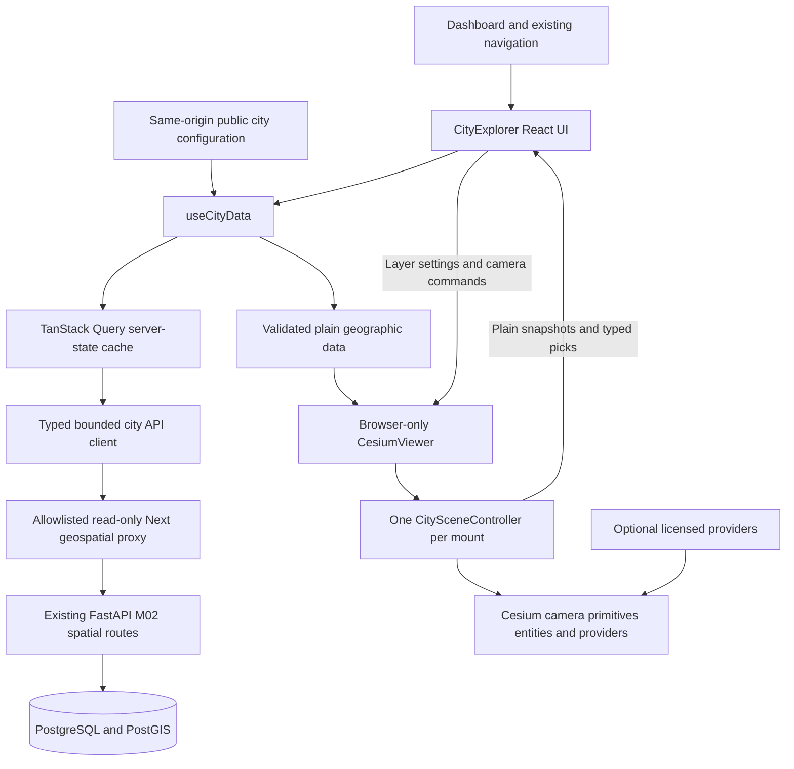

# M03 frontend architecture

M03 extends the existing Next.js App Router application and its mission-control
design. It adds a browser-only Cesium workspace while keeping M01 system health,
diagnostics, shared contracts and the M02 Geospatial Data module intact.
FastAPI and PostGIS remain the geographic service and source of truth; there is
no second geographic database, custom renderer or general-purpose map proxy.

## Runtime boundaries



| Concern | Owner | Stored values |
| --- | --- | --- |
| Server state | `useCityData` and TanStack Query | Validated region/network catalogs, GeoJSON pages, provenance, validation and public viewer configuration |
| UI state | `CityExplorer` | Inspector/layer drawer visibility, feature-list tab, diagnostic-panel visibility and layer preferences |
| Geographic selection | `CityExplorer` and pure selection adapters | Explicit road/intersection category plus stable feature ID, or a bounded provider-building property projection |
| Viewer state | `CesiumViewer` and `CitySceneController` | Native Viewer, camera, event handlers, primitives, entities, provider objects and resource generations |

Cesium native objects are never serialized into general React state or TanStack
Query. React does not own the render loop. Conversely, Cesium does not decide
whether a stored road is synthetic, recompute region area, or invent an
infrastructure record.

## Main modules

- `components/dashboard.tsx` enables City Explorer and keeps the existing
  navigation, design system and earlier modules.
- `components/city/CityExplorer.tsx` composes real server data, plain selection,
  controls, source summaries and the viewer surface. It does not contain Cesium
  native rendering code.
- `FeatureInspector.tsx` formats only supplied feature/provenance attributes.
  It distinguishes missing values from zero/false and renders text safely.
- `LayerManager.tsx` exposes eight controlled native checkboxes. Provider access,
  loading and error states are visible; switches are connected to actual scene
  settings rather than decorative UI state.
- `MapToolbar.tsx` sends discrete camera commands with increasing sequence IDs.
  Selecting the same preset again can therefore trigger a new transition.
- `ViewerErrorBoundary.tsx` handles React subtree rendering failure. Runtime
  WebGL/provider failures are separately reported through typed status callbacks.
- `components/city/CesiumViewer.tsx` owns one browser mount and its disposal guard.
  It imports the runtime controller only after setting the local Cesium asset
  base URL.
- `components/city/runtime/` separates scene orchestration, geographic layers,
  optional providers, camera behavior and async resource generations.
- `lib/city/api.ts` holds bounded HTTP, pagination, geometry/metadata schemas and
  viewport request helpers. `lib/city/types.ts` defines the plain shared types.
- `lib/geo/` holds coordinate, camera-preset and deterministic selection adapters;
  it does not duplicate backend metric or geographic persistence rules.
- `hooks/use-city-data.ts` coordinates actual M02 APIs through TanStack Query.
  `lib/city/config.ts` validates the narrowly public runtime viewer configuration.

The scene is loaded through Next dynamic import with SSR disabled. Server
rendering never constructs a Viewer or accesses WebGL. Cesium Widgets CSS and
its Workers/ThirdParty/Assets/Widgets files are version-matched build assets.
See [Cesium integration](cesium-integration.md) for installation and deployment.

## State flow and request cancellation

The city data hook loads registered regions, resolves the selected/default
region and loads its network catalog. It separately requests the selected
region GeoJSON, public data source and validation report. Stored counts, area,
version identities and provenance remain backend values.

Road and intersection requests use the real same-origin paths:

```text
/api/geospatial/networks/{network_id}/edges?bbox=...&limit=100&offset=...
/api/geospatial/networks/{network_id}/intersections?bbox=...&limit=100&offset=...
```

The allowlisted Next route validates and forwards them to the existing FastAPI
`/api/v1` routes. It is not an unrestricted URL proxy and does not forward the
M02 development write token.

The controller samples the public camera pose at most once every 50 ms, using
ECEF position, direction/up vectors and viewport dimensions. Position movement
of at least 0.05 meters, a direction/up component change of at least 1e-7, or a
viewport-size change resets its movement anchor. Smaller deltas accumulate
against that anchor. The pose is settled after 350 ms without a significant
change. Native move events are hints; post-update sampling also runs while
request-render mode skips an idle draw. This avoids treating tiny native
frustum/transform changes as endless meaningful camera movement.

A settled camera supplies an actual view rectangle. The data hook applies a
separate 350 ms extent debounce, clips the request to the selected region,
quantizes coordinates to six decimal places and builds stable cache keys
containing the region, network, layer and bbox. These two settling/debounce
stages are explicit; 350 ms is not a promised total camera-to-data latency.
Clipping changes the query envelope, not the stored feature coordinates. An
outside-region view or an extent above the one-degree-per-axis query ceiling
produces an explicit no-request state and user guidance. Before a camera
rectangle exists, a sufficiently small selected region can provide the bounded
initial envelope.

Every request combines TanStack's AbortSignal with an 8-second per-request
deadline. Changing region/network cancels obsolete spatial work, and changed
query keys do not reuse previous-region placeholder geometry. Component unmount
also lets TanStack abort unused requests. No new page is accepted after an
aborted signal. The proxy propagates cancellation to its upstream fetch.

A single layer can require multiple sequential pages; 8 seconds is a deadline for
each HTTP request, not a promised total duration for the whole layer. Source,
region and validation calls have their own keys and can load independently.
Slow network responses leave visible loading state rather than a fabricated
success.

## Budgets and schema checks

| Boundary | Enforced display/client limit |
| --- | --- |
| Server page size | 100 features/items |
| Region/network catalog | 500 items each; truncation is explicit |
| Road layer | 500 retained features and 25,000 coordinate positions |
| Intersection layer | 500 retained features and 25,000 coordinate positions |
| JSON response | 4 MiB per HTTP response, including streamed bodies |
| Request deadline | 8 seconds per HTTP request, combined with cancellation |
| Native pose observation | At most once per 50 ms; 350 ms stable within 0.05 m position or 1e-7 direction/up components, with viewport changes included |
| Spatial-query debounce | Additional 350 ms after a changed extent snapshot |
| Query span | At most 1 degree longitude and 1 degree latitude after region clipping |
| Public geometry | 2D finite longitude/latitude; existing M02 per-geometry 5,000-position bound |

The client rejects invalid IDs, unsupported/invalid coordinates, wrong geometry
types, road lines with no geographic extent, nonfinite numeric attributes and
features belonging to another network. Zod schemas retain only the public
fields required for rendering/inspection; private source metadata is not copied
through the browser contract.

Pagination checks offsets, page sizes, totals, repeated IDs and incomplete
pages. Inconsistent snapshots fail visibly and can be retried. Only retained
features reach the scene; an explicit message describes the display budget
instead of implying that all source records are visible. Display caps do not
replace the backend's independent PostGIS/query/integrity limits.

Active TanStack spatial keys retain a 15-second freshness window; equivalent
camera stops reuse the active key. Inactive spatial keys use `gcTime: 0` and are
evicted, preventing many recently visited camera extents from retaining large
coordinate arrays. No unbounded native geometry
cache is introduced. The two-coordinate M02 fixture lines need no simplification;
a future dense source needs a measured LOD/generalization policy.

## Viewer lifecycle and scene updates

`CesiumViewer` keeps its host/controller in refs. A generation guard protects
asynchronous module loading against disposal, React development Strict Mode
cleanup/remount and stale callbacks. Props refresh the controller's current
callback/data view without constructing another Viewer.

The controller changes geographic objects only when relevant geometry arrays,
region/boundary, layer settings or selection change. Roads are batched ground
polylines; intersections share a point collection; the small region boundary
uses polygon hierarchy/entities. Layer toggles change native visibility or
provider ownership. Replaced primitives/entities are removed, and stale
provider completions cannot adopt resources into a disposed scene. A changed
public token or imagery/terrain asset ID replaces only the provider manager;
it does not recreate the Viewer or geographic geometry. Toggling diagnostics
updates observation configuration without replacing providers.

Unmount first marks the controller disposed, cancels camera motion, removes its
camera/render/context-loss listeners and disposes provider generations and
native geographic layers. It then destroys the public
`viewer.screenSpaceEventHandler` before `Viewer.destroy()`. The pinned
Cesium 1.146 implementation guards an already-destroyed handler. Merely removing
a pick action is insufficient: that clears an action mapping, not the handler's
canvas/document event listeners. In the inspected pinned SDK, Viewer/widget
teardown removes actions but does not destroy this public handler itself.

The owned-input cleanup helper still calls Viewer destruction if handler
teardown throws. A second finally-protected helper then requests
`WEBGL_lose_context` when supported and when the owned context is not already
lost. This uses the standard public extension rather than SDK private fields;
unsupported browsers still receive normal SDK cleanup. The application's
context-loss listener is already detached so deliberate disposal cannot report
a stale fatal error to React. The host is cleared, and generation guards reject
late async adoption/callbacks.

An earlier 30-remount browser probe exposed retained DOM/listener growth even
though the viewer canvas disappeared after each unmount. This is why the
lifecycle gate must inspect native event-listener and DOM counters as well as
canvas removal and collected JS heap. That historical defect is not relabeled
as a pass by the cleanup implementation. Final post-change measurements and
remaining limitations belong in [performance](performance.md) and
[verification](verification.md).

Recheck public-handler ownership, the SDK's already-destroyed guard and the
long remount regression when upgrading Cesium. The controller must release only
its own handler/context and must not patch vendor source or hold native objects
in a window-global application store. `CESIUM_BASE_URL` is an asset-path
setting, not a global Viewer reference.

Request-render mode avoids a perpetual application-driven animation loop.
Camera movement and layer changes request rendering; pending asynchronous road
geometry can request frames until ready. Diagnostic status samples are bounded
and deduplicated rather than causing a React update on every rendered frame.

## Requested versus observed scene state

`LayerSettings` records the user's requested enabled switches. `ViewerStatus`
reports renderer phase, provider status, geometry readiness, scene-object counts
and native layer visibility separately. A checked switch is not proof that its
asynchronous layer has loaded.

A road count is nonzero only when its native primitive is enabled and ready.
Intersection counts also apply the distant-camera rule. `geometryReady` tracks
pending road/highlight primitives; it does not certify every external imagery,
terrain or building tile. Native visibility snapshots do not count pixels or
establish full source coverage. Provider `ready` waits for a completed frame and
loaded visible globe tiles. Local context/models also wait for the mount’s public
native geometry batches and a further frame: the pinned SDK latches
DataSourceDisplay.ready, so it alone cannot prove newly added geometry is ready.
Ion buildings require visible nonempty tile content. These gates establish scene
preparation, not per-building pixel visibility or whole-city coverage. Subsequent
tile failures remain latched and visible outside the Layers drawer until a new
load/toggle. See [ADR 0013](decisions/0013-city-rendering-diagnostics.md).

Only with the explicit local diagnostics setting does the scene expose actual
render samples, browser heap observations and a road-pick coordinate projection.
These are plain snapshots of the scene, never native objects or an alternative
data source. Request-render idle samples are not a hardware throughput benchmark,
and browser JS heap omits GPU memory. The actual automated graphics backend
must accompany any observation: a Chromium SwiftShader run measures software
rendering, not Apple Silicon hardware GPU throughput. See
[performance](performance.md).

## Selection, metadata and provenance

Native picks carry explicit `{kind,id}` identities. A bounded drill-pick result
is resolved with priority **intersection → road → building**; a region polygon
cannot win merely because it covers a road. The feature list is an accessible
alternative to canvas picking. Building IDs combine the supplied element type
and element ID when available; missing provider identity uses a mount-scoped
opaque key held by the controller. It is not relabeled as a database UUID or a
verified source identifier. Native feature references remain in a WeakMap,
never in React state. A null pick, Deselect or Escape clears selection.
Selections are scoped to region/network; an ID not present in the current
retained feature set is not shown as a valid road/node selection.

The inspector never infers an intersection from a line crossing or fills missing
signal/building attributes with invented values. It renders safe React text,
bounds provider property keys/values and filters credential-like keys. The
stored synthetic flag is shown explicitly. `is_synthetic=false` is not proof of
verified real-world infrastructure; source type, version, license, attribution
and structural validation remain separate facts requiring review.

## Responsive controls and failures

Desktop uses a large central scene and a right inspector. At narrower tablet
widths the inspector becomes a dismissible overlay drawer. On mobile it uses a
full-width scene, compact controls with touch-sized targets and a bottom-sheet
inspector for selected features. The layer drawer, inspector visibility and
feature tabs are UI state; region switching preserves global layer settings.
Keyboard focus styling, native checkbox/select controls, inspector list buttons,
explicit labels and Escape/deselect support remain part of the interaction.

Missing ion access explicitly blocks optional buildings/terrain and leaves the
local Natural Earth basemap, ellipsoid and backend overlays usable. Invalid
public configuration, backend failure, invalid GeoJSON, empty catalogs, timeout,
WebGL initialization/context loss and optional provider failures have distinct
visible states. The React error boundary does not suppress runtime errors or
claim the scene is ready. Retry data invalidates city queries; retrying the
viewer remounts its native lifecycle while retaining authoritative stored data.

The isolated component/data/lifecycle tests exercise contracts and failure
branches. They do not prove a real browser initialized WebGL, fetched workers,
rendered geometry or released GPU resources. Actual commands, browser runs,
screenshots, limitations and acceptance statuses are recorded only in
[verification](verification.md).


## Real-geography recovery

City Explorer now opens by default, with imported regions/networks separated from
explicit development fixture mode. The full-height scene, native fullscreen,
compact controls and collapsible source details preserve native resource ownership.
Local OSM context validates a streaming12MiB budget, schemas/coordinates,150k
positions and artifact SHA256 before adoption. Unknown metadata/HTML is stripped.
Source-tagged building heights are the only extrusions; ion tiles remain optional.
Local context uses ellipsoid geometry with display-only submeter offsets and no
public raster-tile fetching. Synthetic mode cancels/removes real context and uses
the lightweight global reference. Road metadata preserves narrow inference facts
and bounded source-ID arrays. See recovery-geography.md and actual verification.
