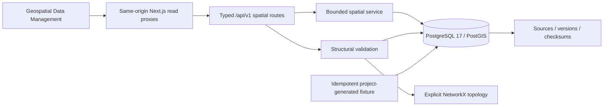

# M02 geospatial architecture

M02 adds permanent geographic persistence, bounded spatial APIs, provenance and
structural validation to the existing M01 modular monolith. It preserves the
same FastAPI factory, validated settings, SQLAlchemy base/async engine, session
provider, PostGIS database and Alembic environment. It does not add another ORM,
spatial microservice or competing connection pool.

## Coordinate and geometry contract

All stored geographic geometry uses EPSG:4326 and every API/GeoJSON position is
`[longitude, latitude]`. Input explicitly uses the `longitude_latitude` convention;
CRS override objects, 3D coordinates, unsupported types, NaN/infinity, malformed
nesting, empty shapes, unclosed polygon rings and invalid geometry are rejected.
Polygon inputs are normalized to MultiPolygon for region storage. No automatic
coordinate swapping or guessed projection conversion occurs.

A pair where both numbers fall inside valid global ranges is inherently
ambiguous: range checks cannot establish human intent. The explicit order
contract and synthetic fixture assertions address that ambiguity. They do not
pretend to recognize every accidentally reversed valid pair.

The parser accepts Point, LineString, Polygon and MultiPolygon. Request size,
coordinate complexity, page size, bbox span, query radius and validation graph
size have documented bounds. Public geometry serialization and database storage
both cap regions/edges at 5,000 coordinates; this prevents a legal database row
from failing the public GeoJSON model solely because of a larger storage budget.

## Measurements and representative centroid

Coordinates are never treated as meter coordinates. Database-generated region
area uses `ST_Area(boundary::geography) / 1000000.0`; generated edge length uses
`ST_Length(geom::geography)`. PostGIS geography measurements use meters/square
meters on the spheroid. Python unit validation independently uses
`pyproj.Geod(ellps="WGS84")`, with polygon ring orientation normalized for area.

Stored centroid policy:

1. Calculate `ST_Centroid(boundary::geography)::geometry`.
2. If `ST_Covers(boundary, candidate)`, use that geographic centroid.
3. Otherwise use `ST_PointOnSurface(boundary)` as a covered representative point.

The fallback is explicit because a mathematical centroid can lie outside a
concave or multipart polygon. The resulting field is a representative centroid,
not a claim that every complex polygon's mathematical center lies inside it.
Generated columns and `ST_Covers` checks enforce the policy; callers do not
supply their own area/centroid values. Contains queries use `ST_Covers`, so points
on a boundary are included. Bounding boxes use west,south,east,north ordering;
antimeridian-spanning boxes are not supported by this M02 API.

## Indexed query design

The service pushes spatial predicates into PostGIS instead of fetching the
entire network for each query:

- Region containment uses the stored boundary and `ST_Covers`.
- Bbox edge filtering applies an index-compatible `&&` prefilter and
  `ST_Intersects` against `ST_MakeEnvelope(...,4326)`.
- Nearby searches use `ST_DWithin` on geography and return `ST_Distance` in
  meters, ordered and bounded by the requested page/radius.
- Intersection polygon filters use indexed point geometry predicates.
- Network bounds use a database extent aggregate, not a Python scan of all
  serialized feature coordinates.

Four GiST indexes cover region boundaries, edge geometry, intersection points,
and the functional expression `road_edges.geom::geography`. The shared
`as_geography` helper uses `Geography(geometry_type=None)` to compile a plain
geography cast. A typmod-bearing cast such as `geography(GEOMETRY,-1)` can produce
an expression that does not match the functional index. The query helper and
index expression must stay aligned; inspect actual plans after changes.

A tiny six-node/eight-edge fixture often makes a sequential scan cheaper. Tests
can use `SET LOCAL enable_seqscan=off` to prove index usability, but that is not a
benchmark or evidence that the planner should always choose an index. Actual
plans and measurements belong in `verification.md`.

## Configurable safety bounds

| Setting | Default | Hard configuration ceiling |
| --- | --- | --- |
| `geo_max_request_bytes` | 262,144 | 1,048,576 |
| `geo_max_coordinates` | 5,000 | 5,000 |
| `geo_max_bbox_degrees` | 1 degree per axis | 5 degrees per axis |
| `geo_max_page_size` | 100 | 100 |
| `geo_max_radius_m` | 5,000 meters | 5,000 meters |
| `geo_max_validation_features` | 10,000 nodes + edges | 100,000 |
| `geo_max_validation_coordinates` | 100,000 aggregate positions | 100,000 |
| `geo_boundary_tolerance_m` | 5 meters | 100 meters |

Limits are validated settings; pagination, query inputs and geometry bodies are
validated before work. Before fetching network geometry for validation, SQL
counts nodes/edges and sums edge coordinate positions plus node positions. The
aggregate 100,000-position budget prevents multiplying the feature budget by
the per-feature 5,000-position budget into a tens-of-millions-coordinate fetch.
Bound SQLAlchemy expressions and PostGIS functions are used instead of
concatenating user strings into SQL. Existing connection-pool
and statement-timeout bounds remain in force. Public source serialization is a
whitelist and does not dump private JSONB or credential-bearing source URLs.

## Topology and validation semantics

Road edges explicitly reference start/end intersection UUIDs with composite
same-network foreign keys. A line crossing another line never creates an edge
in the graph automatically. Geometry endpoints are checked against their declared
node positions using geodesic distance and a 0.5-meter endpoint tolerance.

Structural validation checks nonempty content, geometry types/SRIDs/ranges,
identifier uniqueness, network references, lane/speed/length validity,
metadata, expected counts, region coverage, duplicate edge signatures, isolated
nodes and connected components. Region coverage uses a configurable geography
buffer in meters. NetworkX uses an undirected graph for weak structural
connectivity; this is not a directed routing, turn-restriction or drivability
validation engine. One-way information is preserved as metadata for later work.

| Report status | Meaning of `validated` | Findings |
| --- | --- | --- |
| `VALID` | true | No integrity errors or warnings |
| `VALID_WITH_WARNINGS` | true | Integrity passes; descriptive metadata or weak-connectivity warnings may remain |
| `INVALID` | false | One or more integrity errors |
| `NOT_VALIDATED` | false | Configured feature or aggregate-coordinate budget prevented traversal |

Warnings do not mean all check flags are true: a disconnected graph can have
`connectivity_valid=false` and still receive the explicitly documented
`VALID_WITH_WARNINGS` state. Invalid geometry, endpoint/reference disagreements,
invalid attributes, count mismatches, detected duplicates and outside-tolerance
edges are errors.

For a feature- or coordinate-budget-limited report, actual node/edge counts are
available from SQL, while `components` and `isolated_nodes` are NULL because no traversal ran.
`checks` is empty and a budget warning explains why. NULL must not become zero,
and `NOT_VALIDATED` must not be presented as either valid or geometrically
invalid. On-demand validation reports do not silently mutate published network
content. A stored validation summary is a version snapshot, distinct from a new
bounded validation request.

## Versioning and provenance

Region/version labels and region/content checksums are unique. Published and
archived version rows and their node/edge geometry are protected by database
triggers. Child changes lock the parent rows, so publishing and editing serialize
rather than race. A draft child edit invalidates its validation snapshot; a
published correction requires a new version. Scenario/demand references are
protected by a same-network composite foreign key.

Data sources preserve provider, dataset name/type, original metadata, declared
license, attribution, collection time, source version and SHA-256. A public URL
does not establish a license. Public endpoints return only approved descriptive
fields; internal original metadata stays private. Artifact URIs are metadata
contracts, not a promise that an object-storage service has been implemented.

The seeded `dubai-downtown-demo` boundary is a small project-generated
illustrative polygon near Downtown Dubai. It is not an official municipal
boundary. Its six intersections, eight links, one simulated signalized node,
provisional identifiers and mixed one-way flags are all synthetic. The source
uses an explicit project license reference and attribution; collection time is
recorded on first insert. A deterministic manifest checksum and stable UUIDs
make repeat seeds verifiable and idempotent without rewriting published data.

## Security and milestone boundary

M02 adds a local development write token, not a user login system. Region
creation requires the configured `X-Earthmind-Dev-Token`; absent configuration
disables writes, and missing/wrong credentials are rejected. Existing Compose
ports stay loopback-only. Users/password-hash/role fields are persistence
contracts; no default account or plaintext credential is seeded.

External exposure requires a real identity/authorization boundary, database role
separation and the deployment controls described in `security.md`. Audit
metadata must never contain credentials. No live RTA/OSM extraction, SUMO network
conversion, Cesium integration, AI prediction, traffic-light optimization or
simulation executor is implemented in M02. M01's independent tiny SUMO runtime
fixture remains a regression requirement, not proof that the new road graph has
verified SUMO identifiers or can be driven by SUMO.

## Decisions and references

The schema favors database-enforced invariants because API-only validation
cannot protect concurrent/direct persistence. GeoAlchemy2 provides spatial ORM
integration; PostGIS performs indexed queries/metric measurements; Shapely
handles bounded GeoJSON validity; pyproj supplies independent geodesic checks;
NetworkX handles explicit, bounded structural connectivity.

- [GeoAlchemy2 Alembic integration](https://geoalchemy-2.readthedocs.io/en/latest/alembic.html)
- [PostGIS ST_Area](https://postgis.net/docs/ST_Area.html)
- [PostGIS ST_Length](https://postgis.net/docs/ST_Length.html)
- [PostGIS ST_DWithin](https://postgis.net/docs/ST_DWithin.html)
- [PostGIS ST_Covers](https://postgis.net/docs/ST_Covers.html)
- [PostGIS ST_Centroid](https://postgis.net/docs/ST_Centroid.html)
- [PostGIS ST_PointOnSurface](https://postgis.net/docs/ST_PointOnSurface.html)
- [pyproj Geod](https://pyproj4.github.io/pyproj/stable/api/geod.html)
- [Database relationships and migration safety](database-schema.md)
