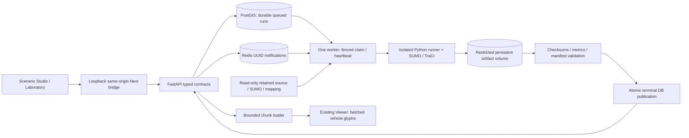

# M04 SUMO architecture

EARTHMIND executes real SUMO experiments using **synthetic passenger demand** on
retained OSM-derived Dubai geography. Results are not observed RTA traffic,
calibrated demand, validated signal timing or causal congestion forecasts.
M01 diagnostics and M02–M03.5 geography/Cesium remain separate working systems.



Canonical contracts are in `packages/contracts/src/earthmind_contracts/simulation.py`.
The API extends the existing Base and Scenario/DemandProfile/SimulationRun,
RunMetric and RunArtifact models. Additive migration0005 adds execution metadata,
progress, idempotency, leases, versioned nullable metrics, artifact sizes/MIME,
bounded events and persistent comparisons. Frozen migrations0001–0004 are unchanged.

PostgreSQL queued rows are the durable work source. Redis carries bounded UUID
hints and is not the authority for a run state. The worker polls durable rows,
claims queued→running atomically, releases the claim transaction, then performs
native execution outside HTTP handlers. Native concurrency is one and shares the
M01 native-runtime lock. Worker heartbeat and cancellation polling remain async.

```mermaid
sequenceDiagram
  participant U as Browser
  participant A as API
  participant D as PostgreSQL
  participant W as Worker
  participant S as SUMO
  participant F as Artifact volume
  U->>A: Validate / create scenario
  A->>D: Commit immutable configuration
  A-->>U: 201 after transaction finalizer
  U->>A: Submit + Idempotency-Key
  A->>D: Commit durable queued run
  A-->>U: 202 after commit
  W->>D: Atomic claim + worker identity
  W->>S: Fixed allowlisted argv in isolated process group
  loop Each real simulation step
    S-->>W: Native time / vehicles / events
    W->>F: Stream bounded trajectory chunks
    W->>D: Actual progress + lease heartbeat
  end
  W->>F: Validate outputs; rename complete directory
  W->>D: Fenced transaction: metrics + artifacts + succeeded
  U->>A: Poll result / fetch verified manifest and chunks
  A-->>U: Metrics and original checksum-matching replay bytes
```

M04's function-scoped session dependency commits before success headers. This
prevents a fast follow-up request from observing a 201/202 record before its
transaction is visible. M02's prior dependency alias is retained.

The worker uses the existing Infrastructure/session factory in its process,
through the declared `earthmind-api` workspace dependency; no competing ORM Base
or second migration environment is introduced. This adds no new registry version;
its package versions remain locked. Native children receive an allowlisted runtime
environment, excluding database, Redis, developer-write and Cesium credentials.

The retained network is reused, never silently rebuilt/downloaded. Every route
uses verified imported edge IDs, directed passenger permissions and actual SUMO
connections; native internal junction lanes are retained for execution/alignment.
Source ways can map to multiple directional/split edges. The node graph and
restricted edge-connection graph have different component semantics; see the
actual audit in verification rather than assuming one connectivity number.

Named `simulation_artifacts` storage is initialized for UID/GID10001 with mode0750.
Only worker mounts it read/write; API mounts it read-only. Inputs are read-only.
A successful run directory is immutable; cancelled/failed/unpublished directories
are not advertised as valid results. No S3/cloud object store is claimed.

See [execution](simulation-execution.md), [demand](traffic-demand.md),
[metrics](traffic-metrics.md), [API](simulation-api.md), [replay](replay-engine.md)
and [verification](verification-m04.md). Real identity, tenant authorization,
public deployment, managed secrets/backups and retention remain operator work.
